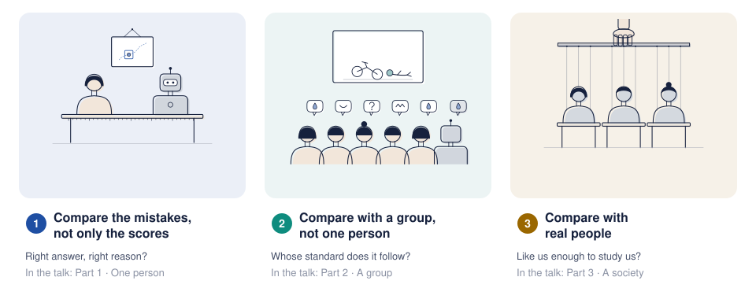
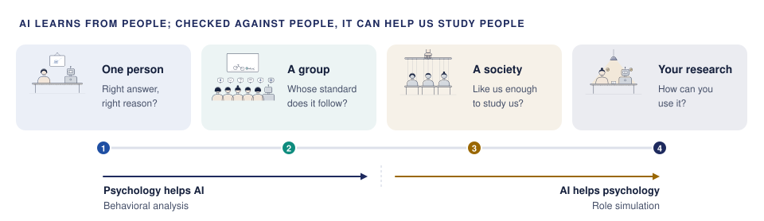

**English** · [中文](README.zh.md)

# Studying the Human Mind with AI

**A reading companion to the talk *Studying the Human Mind with AI: From Behavioral Analysis to Role Simulation*.** Where to read about what
the talk showed, what its key terms mean, which studies to learn from, and how they connect.
No code is needed.

The talk asked one question: **it looks capable; how would we know it really is?** A new name for
AI does not settle what intelligence is. Turing suggested testing a machine against people instead,
and in a recent run of his test, judges picked GPT-4.5 with a persona as the human 73% of the time.
Being picked as human tells us about the judges' cues, not yet about the machine's mind; the test
also tells us about ourselves. Psychology has studied minds through behaviour, against people, for
a century. The talk in one sentence: **AI learns from people; checked against people, it can help
us study people.** It asks four questions, each a little bigger than the last: one person, a group,
a society, and your own research. Halfway, the direction changes: at first psychology helps us test
AI (behavioral analysis, Parts 1–2); later, AI helps us study people (role simulation, Parts 3–4).

## The talk in four parts

| Part | The question, and the talk's answer | Guide | Key readings |
|---|---|---|---|
| 1 · One person: people next to the machine | Right answer, right reason? Not yet: close scores, different mistakes. **Compare the mistakes, not only the scores.** | [guide](docs/part1-people-next-to-machine.md) | [five studies](docs/part1-people-next-to-machine.md#key-readings) |
| 2 · A group: people as the answer | Whose standard does it follow? A group of people, not one person. **Compare with a group, not one person.** | [guide](docs/part2-people-as-the-answer.md) | [five studies](docs/part2-people-as-the-answer.md#key-readings) |
| 3 · A society: people we make | Is it like us enough to study us? To rehearse a study, not to replace its people. **Compare it with real people.** | [guide](docs/part3-people-we-make.md) | [five studies](docs/part3-people-we-make.md#key-readings) |
| 4 · AI in your own research | How can you use it? **Check it first, then use it**, at each of the five places a model can enter a study. | [guide](docs/part4-ai-in-your-research.md) | [five studies](docs/part4-ai-in-your-research.md#key-readings) |

Each guide has the same sections:
- what the talk showed and the question behind it;
- what it gives back to psychology;
- five key readings, each summarised on the page and in a one-page card, and how they connect;
- the wider landscape of checked references, and the talk's own studies;
- the terms used;
- how to work on it with an AI researcher.

## Where to start

- **Just heard the talk?** [Start here](docs/start-here.md): five minutes, then the part you remember best.
- **Want to read systematically?** The [reading path](resources/reading-path.md): an afternoon's start, one part at a time, then the debates.
- **Want to start a study with an AI researcher?** The [guide to working together](resources/working-together.md): what each side brings, what to agree on, and a published study to learn from for each part.
- **Met an unfamiliar term?** The [glossary](docs/glossary.md).
- **Prefer paper, or GitHub is slow where you are?** The [printable handout](docs/handout/handout.pdf).

## What is here

**How much there is to read.** About 300 checked references in all (about 285 distinct DOIs and arXiv records, plus books and proceedings pages), in four layers:

| Layer | What | How many |
|---|---|---|
| Close reading | [key readings](resources/examples/), one page each: five for each of the four parts, and two more for the opening and a backup page | 22 cards |
| A path through them | the [reading path](resources/reading-path.md): an afternoon's start, the key readings in order, then the debates | 4 + 20 + 20 |
| The wider field | the [field-wide list](resources/literature.md), in 19 groups across Parts 1–3 (101, 102 and 108 entries); about 250 papers, 49 data sets and 13 simulation platforms | 311 entries |
| Other ways in | reading lists [by part of the talk](resources/README.md) (53) and [by area of psychology](resources/students.md) (46, in five areas), which overlap with the above | 99 entries |

And where each thing lives:

| Folder | What it holds |
|---|---|
| [`docs/`](docs/) | the start page, one guide per part of the talk, the glossary, the handout and the talk's drawings |
| [`resources/`](resources/) | the reading path; the [key-reading cards](resources/examples/); reading lists [by part of the talk](resources/README.md), [by area of psychology](resources/students.md) and [field-wide](resources/literature.md); a [guide to working together with AI researchers](resources/working-together.md) |

Every reference was checked against its publisher, Crossref, arXiv or OpenReview before it was
added. Links only: no papers are copied here.

## About

Written and organised by **Shiyu Hu**, Research Fellow, School of Physical and Mathematical
Sciences, Nanyang Technological University, Singapore ([homepage](https://hushiyu1995.com)).
The structure follows the talk.

This repository belongs to the *Humans and AI* line of the author's
[research](https://hushiyu1995.com/#research-framework), which asks what counts as being right
when people disagree, or when AI takes people's place or works with them.

The author is an AI researcher, not a psychologist, so the reading of psychology here may be
incomplete, or differ from how psychologists would put it. Corrections and discussion are very
welcome: [open an issue](https://github.com/huuuuusy/studying-the-mind-with-ai/issues) or write to shiyu.hu@ntu.edu.sg.

## How to cite

Use **Cite this repository** on GitHub, or the [`CITATION.cff`](CITATION.cff) file: Hu, S. (2026). *Studying the Human Mind with AI: From Behavioral Analysis to Role Simulation. A reading companion to the talk*. Zenodo. [doi:10.5281/zenodo.23684070](https://doi.org/10.5281/zenodo.23684070) Please cite
the original studies for anything you take from them.

## Contributing

Corrections, broken links and suggested readings are welcome; see
[CONTRIBUTING.md](CONTRIBUTING.md).

## Licence

- **Text and the diagrams made for this repository:** [CC BY-NC 4.0](LICENSE). You may share
  and adapt them for non-commercial purposes, including teaching, with attribution.
- **The talk's drawings** in [`docs/figures/talk/`](docs/figures/talk/): © Shiyu Hu, all rights
  reserved; see [the notice](docs/figures/talk/NOTICE.md).
- **The small scripts** that build the figures, the handout and the link check: [MIT](LICENSE-code.txt).
- **The studies described here** remain the work of their authors; cite the original papers.
