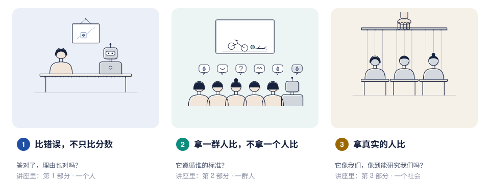
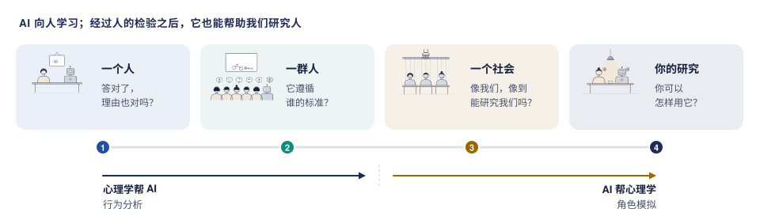

[English](README.md) · **中文**

# Studying the Human Mind with AI

**讲座 *Studying the Human Mind with AI: From Behavioral Analysis to Role Simulation*（用 AI 研究人的心智：从行为分析到角色模拟）的配套阅读指南。** 讲座里讲到的内容去哪里读，关键术语是什么意思，该从哪些研究学起，以及它们之间的关系。不需要写代码。

讲座只问了一个问题：**它看起来很有能力，我们怎么知道它真的具备这种能力？** 给 AI 换个名字，并不能说清智能是什么。图灵提出的办法是拿人来检验机器；在最近一次重做的图灵测试里，有人设的 GPT-4.5 有 73% 的时候被评判者选成真人。被选成人，反映的是评判者用了哪些线索，还不能说明机器有怎样的心智；这个测试也让我们了解自己。一百多年来，心理学也一直从行为出发、拿人来比，研究心智。讲座的一句话：**AI 向人学习；经过人的检验之后，它也能帮助我们研究人。** 讲座问了四个问题，一个比一个大：一个人、一群人、一个社会，再到你自己的研究。走到一半，方向反了过来：前半程是心理学帮我们检验 AI（行为分析，第 1–2 部分），后半程是 AI 帮我们研究人（角色模拟，第 3–4 部分）。

## 讲座的四个部分

| 部分 | 问题，和讲座的回答 | 导读 | 重点必读 |
|---|---|---|---|
| 1 · 一个人：机器旁边的人 | 答对了，理由也对吗？还没有：分数相近，错误不同。**比错误，不只比分数。** | [导读](docs/part1-people-next-to-machine.zh.md) | [五篇研究](docs/part1-people-next-to-machine.zh.md#重点必读) |
| 2 · 一群人：人作为答案 | 它遵循谁的标准？一群人，而不是一个人。**拿一群人比，不拿一个人比。** | [导读](docs/part2-people-as-the-answer.zh.md) | [五篇研究](docs/part2-people-as-the-answer.zh.md#重点必读) |
| 3 · 一个社会：我们造出来的人 | 它像我们，像到能研究我们吗？用来预演一项研究，不能取代研究里的人。**拿真实的人比。** | [导读](docs/part3-people-we-make.zh.md) | [五篇研究](docs/part3-people-we-make.zh.md#重点必读) |
| 4 · 在你自己的研究里用 AI | 你可以怎样用它？**先检验，再使用**，在模型可以进入研究的五个环节里都是这样。 | [导读](docs/part4-ai-in-your-research.zh.md) | [五篇研究](docs/part4-ai-in-your-research.zh.md#重点必读) |

每部分的导读都有相同的几节：
- 讲座里讲了什么，以及背后的问题；
- 反过来，对心理学有什么用；
- 五篇重点必读，每篇在导读里有概述，另有一张一页纸的卡片，以及它们之间的关系；
- 更大的版图：核实过的参考文献，以及讲座里讲者团队自己的研究；
- 用到的术语；
- 怎样和 AI 研究者一起做。

## 从哪里开始

- **刚听完讲座？** [从这里开始](docs/start-here.zh.md)：五分钟，然后去你印象最深的那一部分。
- **想系统地读？** [阅读路线](resources/reading-path.zh.md)：先用一个下午入门，再一部分一部分读，最后读争论。
- **想和 AI 研究者一起做研究？** [一起做研究的指南](resources/working-together.zh.md)：两边各带来什么、要谈妥什么，以及每部分一项可以借鉴的已发表研究。
- **遇到不认识的术语？** 查[词典](docs/glossary.zh.md)。
- **更喜欢纸质的，或者你那里访问 GitHub 很慢？** 下载[可打印的讲义](docs/handout/handout.zh.pdf)。

## 这里有什么

**可读的内容有多少。** 合计约 300 篇核实过的参考文献（约 285 个不同的 DOI 和 arXiv 编号，另有书籍和会议页面），分四层：

| 层次 | 内容 | 数量 |
|---|---|---|
| 精读 | [重点必读卡片](resources/examples/README.zh.md)，每篇一页：讲座四个部分各五篇，另有两篇配合开场和一张备用页 | 22 张 |
| 一步一步读 | [阅读路线](resources/reading-path.zh.md)：一个下午的入门，按顺序读重点必读，最后读争论 | 4 + 20 + 20 篇 |
| 更大的版图 | [全领域文献清单](resources/literature.md)（英文），第 1–3 部分共 19 组（101、102、108 条）；其中约 250 篇论文、49 个数据集、13 个模拟平台 | 311 条 |
| 其他入口 | [按讲座部分](resources/README.md)（53 条）和[按心理学方向](resources/students.md)（46 条，五个方向）的阅读清单（英文），和上面有大量重合 | 99 条 |

各部分放在哪里：

| 文件夹 | 里面有什么 |
|---|---|
| [`docs/`](docs/) | 开始页、讲座每部分一篇导读、词典、讲义，以及讲座里的插图 |
| [`resources/`](resources/) | 阅读路线；[重点必读卡片](resources/examples/README.zh.md)；阅读清单，分为[按讲座部分](resources/README.md)、[按心理学方向](resources/students.md)和[全领域](resources/literature.md)三种（英文）；[与 AI 研究者一起做研究的指南](resources/working-together.zh.md) |

每篇参考文献在收录之前都对照出版方、Crossref、arXiv 或 OpenReview 核实过。这里只放链接，不复制任何论文。

中文页面与英文页面放在一起，文件名带 `.zh` 后缀；文献条目保留英文原文。

## 关于

由 **Shiyu Hu**（新加坡南洋理工大学数理科学学院 Research Fellow，[个人主页](https://hushiyu1995.com)）撰写和整理。结构沿用讲座。

这个仓库属于作者[研究主线](https://hushiyu1995.com/#research-framework)中的 *Humans and AI*（人与 AI）这条线：人们意见不一时，或者 AI 代替人、和人一起工作时，什么才算对。

作者是 AI 研究者，不是心理学家，这里对心理学的理解可能不完整，也可能和心理学界的看法有出入。非常欢迎指正和交流讨论：可以[提一个 issue](https://github.com/huuuuusy/studying-the-mind-with-ai/issues)，或者写信到 shiyu.hu@ntu.edu.sg。

## 如何引用

使用 GitHub 上的 **Cite this repository**，或者 [`CITATION.cff`](CITATION.cff) 文件：Hu, S. (2026). *Studying the Human Mind with AI: From Behavioral Analysis to Role Simulation. A reading companion to the talk*. Zenodo. [doi:10.5281/zenodo.23684070](https://doi.org/10.5281/zenodo.23684070)凡是从原始研究中取用的内容，请引用原始论文。

## 参与贡献

欢迎指出错误、失效的链接，或者推荐文献；见 [CONTRIBUTING.md](CONTRIBUTING.md)（英文）。

## 许可

- **文字以及为这个仓库制作的图表：** [CC BY-NC 4.0](LICENSE)。你可以在署名的前提下，为非商业目的（包括教学）分享和改编它们。
- **讲座里的插图**，位于 [`docs/figures/talk/`](docs/figures/talk/)：© Shiyu Hu，保留所有权利；见[说明](docs/figures/talk/NOTICE.md)。
- **用来生成图表、讲义和链接检查的小脚本：** [MIT](LICENSE-code.txt)。
- **这里介绍的研究**仍然属于它们的作者；请引用原始论文。
