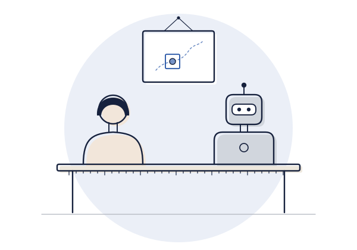
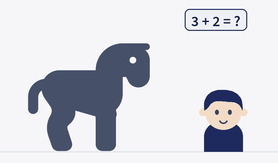
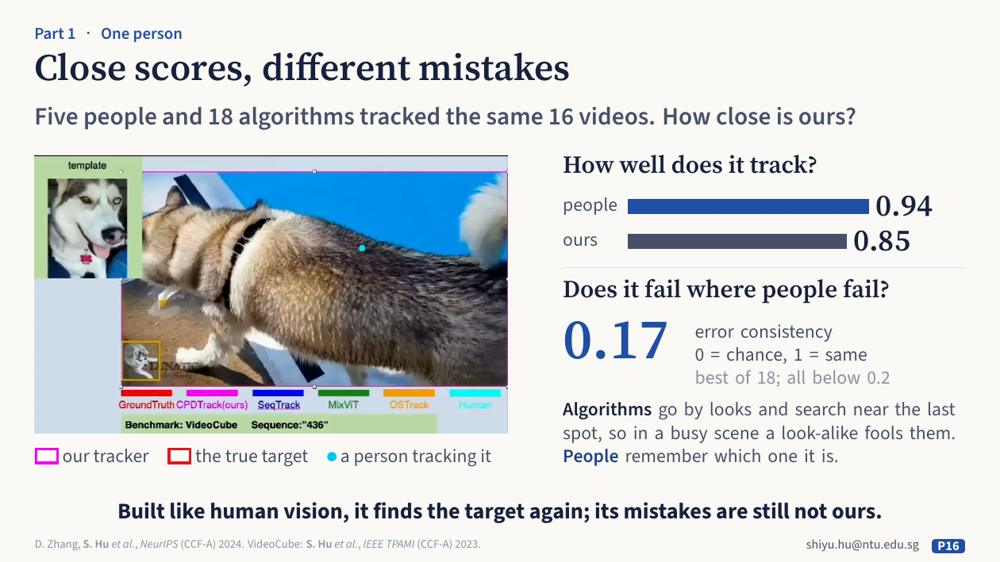
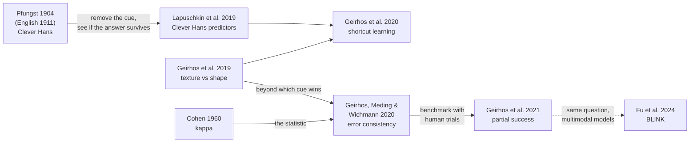

**English** · [中文](part1-people-next-to-machine.zh.md)

# Part 1 · One person: people next to the machine

*Right answer, right reason? The check: **compare the mistakes, not only the scores**.*

## What the talk showed

**What psychology already knew.** Clever Hans, the horse who seemed to count, was tested by changing one thing: did the questioner know the answer? When the questioner knew, Hans was right 98% of the time. When the questioner did not know, he was right 8% of the time. Hans was reading tiny, unintended movements of the questioner's head, not doing arithmetic. Behaviour that looks like an ability is not yet evidence of it; a controlled comparison is.

**The classic work in AI.** AI has its own Clever Hans. Sebastian Lapuschkin and colleagues found a model that recognised horses by a source tag on the photos, not by the horse. Robert Geirhos and colleagues in Tübingen showed that networks trained on ImageNet (a large collection of labelled photos) call a cat with the skin of an elephant an elephant: they go by texture, people go by shape. Geirhos and colleagues named the general problem shortcut learning: a cue that works in training, not the ability we meant. To catch a shortcut when the score looks fine, compare the mistakes: two systems with the same score can fail on different images. Geirhos and colleagues measured this with Cohen's κ on which images each one gets wrong. On one set of images it was 0.33 between people, and only 0.07 between networks and people. Later, the best models matched people's accuracy, but not their errors.

**What the speaker's group built.** Tracking, with people as the reference. Tracking means following one object through a video, even when it goes out of sight. First came a harder, more human-like task: the shot cuts, the target disappears, then comes back somewhere else. On it, people did better than twenty tracking algorithms. A clip from the group's human–machine study shows the difference. Among look-alike flamingos, a person stays on the same bird; a state-of-the-art algorithm jumps to another bird that looks similar. The person keeps to the target; the algorithm goes by looks. Then came a tracker built from how people find a target again, CPDTrack. Wide peripheral vision picks where to look; narrow central vision checks what is there. Five people and 18 algorithms tracked the same 16 videos. People scored 0.94, and CPDTrack scored 0.85, the best of the 18. But its error consistency with people was only 0.17 (0 is chance, 1 the very same errors). It finds the target again, but its mistakes still fall at different moments from people's.

*Slide 16 of the talk: close scores, different mistakes.*

## The question behind it

**Right answer, right reason?** Not yet: close scores, different mistakes. A similar score is not a similar process. To compare a model with people, compare **which** items each gets wrong, not only how many, and put the cue you suspect in conflict with the one you intend: a controlled comparison, in psychology's terms. The human reference is the spread among people, not a ceiling of 100%.

**To check the reason, compare the mistakes, not only the scores.**

## What it gives back to psychology

The tests also teach us about people, here about how we see. But a model built from a theory of human vision does not test that theory on its own. Taking one part of the tracker away shows what the model needs, not how people see. Whether the split between central and peripheral vision holds for people needs people: for example, masking central or peripheral vision and seeing whether the same kinds of error rise. The talk leaves this as an open question: do a model's parts fail like ours?

## Key readings

Read these five first. Each one below says what was done, what was found, what it means for this part's question, and what it does not show; its card gives the method in full and where the data are.

### 1. [A cat with elephant skin: ImageNet-trained networks see texture, people see shape](../resources/examples/geirhos2019-texture-bias.md)

Geirhos et al., 2019, *ICLR*

**What they did.** A cue-conflict design, the standard way perception research asks which of two cues an observer uses. Style transfer (a method that redraws one image in the texture of another) gave each image the shape of one category and the texture of another, and people and networks classified the same images. The human data come from laboratory psychophysics: nine experiments, 48,560 trials, 97 observers.

**What they found.** Networks trained on ImageNet, a large collection of labelled photos, are strongly biased towards texture, while people decide by shape. Trained on *Stylized-ImageNet*, whose textures have been replaced, the same network design (ResNet-50, a standard image network) learns a shape-based representation instead, fits human behaviour better and is more robust to image distortions.

**What it means here.** This is the talk's cat with elephant skin, and the plainest form of this part's question: put the suspected cue in conflict with the intended one and see which wins, for people and machines alike. The answer also depends on training data, not only on the architecture.

**What it does not show.** Shape versus texture is one cue dimension among many. People and a model can agree on which cue wins and still fail on different images; reading 2 measures that.

### 2. [Close scores, different mistakes: error consistency](../resources/examples/geirhos2020-error-consistency.md)

Geirhos, Meding & Wichmann, 2020, *NeurIPS*

**What they did.** For every trial they recorded whether each decision maker was right or wrong, and compared how often two of them are wrong on the same trials with how often chance would predict from their accuracies. The index is Cohen's κ on right and wrong, a statistic from psychological measurement, usable for model–model, person–person and model–person pairs.

**What they found.** On object recognition, networks of any architecture are remarkably consistent with one another, but their consistency with human observers is little above chance. CORnet-S, a model of the brain's object-recognition pathway with loops that feed signals back (recurrent), behaves here essentially like a standard image network in which signals pass only one way (feedforward ResNet-50).

**What it means here.** This is this part's check in its exact form: compare which items each system gets wrong, not only how many. It goes one step beyond reading 1, from which cue wins to whether failures fall on the same images, and turns "the model processes images like people do" into a test that can fail.

**What it does not show.** Consistent errors are necessary for a shared strategy but not sufficient, and a low κ alone does not identify which shortcut the model uses. Read κ against the consistency among people, not against an ideal of 1.

### 3. [A right answer found in the wrong place: Clever Hans predictors](../resources/examples/lapuschkin2019-clever-hans.md)

Lapuschkin et al., 2019, *Nature Communications*

**What they did.** Explanation methods show which parts of an input a model relied on, and the paper's Spectral Relevance Analysis (SpRAy) groups these maps across many inputs, so that whole strategies show up, not single cases. The decisive test is the one Oskar Pfungst used on Clever Hans in 1904: remove the suspected cue and see whether the answer survives, then add it where it does not belong and see whether the answer follows.

**What they found.** An image classifier (a Fisher vector classifier, an older, pre-deep-learning kind) trained on PASCAL VOC 2007, a public photo collection, recognised horses by a source tag that appears in about one-fifth of the horse images. Removing the tag removed the horse classification; adding it to a car image changed that image's classification.

**What it means here.** This is AI's own Clever Hans from the talk, and its logic is psychology's: a manipulation that removes the cue is a control condition. Geirhos and colleagues later named the general problem shortcut learning. Reading 2 can show that a model differs from people; this shows how to pin down the cue it uses instead.

**What it does not show.** Explanation maps are measurements that need their own validation: they show where the model looked, not why. The removal and insertion test is what makes the conclusion convincing.

### 4. [Partial success: the robustness gap closes, the consistency gap does not](../resources/examples/geirhos2021-partial-success.md)

Geirhos et al., 2021, *NeurIPS*

**What they did.** People were tested on out-of-distribution data sets, images unlike those the models were trained on, such as noisy, stylised or edge-only images: 85,120 psychophysical trials across 90 participants. The models differed from standard networks trained on labelled photos in what they were trained to do, in their design and in how many images they learned from (1 million to 1 billion), and each was compared with people on accuracy and on image-level error consistency.

**What they found.** The robustness gap is closing: on most data sets the best models now exceed human performance under brief presentation. A substantial image-level consistency gap remains, and most models agree with one another in their errors. In many cases, consistency with people improves when the training set grows 10 to 1,000 times larger.

**What it means here.** This is the talk's point that, later, the best models matched people's accuracy, but not their errors. It shows why accuracy and error consistency must be reported separately: whether a model is "more human-like" depends on which one you measure. The human trial data are public.

**What it does not show.** The human data come from brief presentation of single images, so they describe fast recognition, not everything human vision does. The results describe the models tested in 2021.

### 5. [Seeing but not perceiving: BLINK](../resources/examples/fu2024-blink.md)

Fu et al., 2024, *ECCV* (BLINK)

**What they did.** Fourteen classic computer vision tasks, such as relative depth, visual correspondence and forensics detection, were reformatted into 3,807 multiple-choice questions with one or more images, put to multimodal language models (chat models that take images as well as text). Human accuracy on the same questions is the baseline; random guessing gives a second reference point.

**What they found.** People reach 95.70% accuracy on average. The best models at the time, GPT-4V and Gemini, reach 51.26% and 45.72%, only 13.17 and 7.63 percentage points above random guessing. Specialist computer vision models do much better.

**What it means here.** Not shown in the talk, it carries this part's question from image classifiers to the chat-style models that most people now use: fluent answers can hide weak perception. Read it last, for how far the question reaches today.

**What it does not show.** It compares accuracy only, not which items people and models fail on, the step reading 2 would add. The results describe the models tested in 2024; newer models should be tested again.

## How they connect

Three threads run through these readings.

- **The cue.** Pfungst showed in 1904 that Clever Hans answered from tiny, unintended movements of his questioner's head, by removing that cue and watching the answers fail. [Lapuschkin et al.](../resources/examples/lapuschkin2019-clever-hans.md) applied the same logic to a classifier. Geirhos et al. (2020, *Shortcut learning in deep neural networks*, [doi](https://doi.org/10.1038/s42256-020-00257-z)) then gave the general name: shortcuts are decision rules that work on standard benchmarks but fail under harder test conditions. That paper notes that related problems are known in comparative psychology, education and linguistics.
- **The measurement.** The [texture-bias study](../resources/examples/geirhos2019-texture-bias.md) asks which of two cues wins. [Error consistency](../resources/examples/geirhos2020-error-consistency.md) goes one step further: do people and models fail on the *same* images? It borrows Cohen's κ, a statistic from psychological measurement. [Partial success](../resources/examples/geirhos2021-partial-success.md) applies both to many newer models and publishes the human trials.
- **The scope.** The same comparison now reaches multimodal language models. [BLINK](../resources/examples/fu2024-blink.md) reports accuracy against a human baseline; it does not yet report which items people and models fail on, which is the natural next step.

**The open question.** *Partial success* finds that models now match or beat people on robustness while still failing on different images. Whether a model is "more human-like" depends on which of the two you measure, so report both.

## The wider landscape

The [field-wide list](../resources/literature.md#part-1--one-person-people-next-to-the-machine) has 101 checked references for this part, grouped as follows.

| Group | What it covers | Entries |
|---|---|---|
| [Human–machine comparison in vision](../resources/literature.md#humanmachine-comparison-in-vision) | psychophysics with networks and people: degraded and cue-conflict images, primate behaviour, robustness | 17 |
| [LLMs and VLMs on cognitive-psychology tasks](../resources/literature.md#llmsvlms-on-cognitive-psychology-tasks-and-batteries-incl-critiques) | classic tasks and test batteries given to language and vision–language models, with the critiques of this practice | 29 |
| [Process and evidence evaluation](../resources/literature.md#process-and-evidence-evaluation-grounding-gaze-stepwisecausal-reasoning-calibration) | whether a right answer rests on the right evidence: grounding, gaze, step-by-step and causal reasoning, calibration | 14 |
| [AI as models of the mind and brain](../resources/literature.md#ai-as-models-of-the-mind-and-brain-incl-critiques) | networks as models of human cognition and neural data, with critiques | 13 |
| [Cognitive-theory-guided model design](../resources/literature.md#cognitive-theory-guided-model-design-evaluated-against-people) | models built from a theory of human perception or cognition and then tested against people | 13 |
| [Benchmarks and data sets with trial-level human data](../resources/literature.md#benchmarks-and-datasets-with-trial-level-or-item-level-human-data) | where to find human responses item by item, with access and licence | 15 |

For readings by area of psychology, see the [list for psychology students](../resources/students.md#cognitive-psychology-and-neuroscience).

## The talk's own studies

The speaker's group, in their public versions (\* equal contribution). Read them after the key readings; they are where the talk's own examples come from.

- **The task: following one object through shot cuts, with people tested next to twenty algorithms.** Hu, S., Zhao, X., Huang, L., & Huang, K. (2023). Global instance tracking: Locating target more like humans. *IEEE TPAMI*, 45(1), 576–592. [doi](https://doi.org/10.1109/TPAMI.2022.3153312)
- **The same task with language and long videos.** Hu, S., Zhang, D., Wu, M., Feng, X., Li, X., Zhao, X., & Huang, K. (2023). A multi-modal global instance tracking benchmark (MGIT): Better locating target in complex spatio-temporal and causal relationship. *NeurIPS 2023, Datasets and Benchmarks*. [doi](https://doi.org/10.52202/075280-1087)
- **The tracker built from how people find a target again (CPDTrack), and its errors compared with people's.** Zhang, D., Hu, S., Feng, X., Li, X., Wu, M., Zhang, J., & Huang, K. (2024). Beyond accuracy: Tracking more like human via visual search. *NeurIPS 2024*. [doi](https://doi.org/10.52202/079017-0086)
- **The human–machine tracking study, with the flamingo clip and people as a range.** Zhao, X., Hu, S., & Yin, X.-C. (2025). *Visual object tracking: An evaluation perspective*. Springer. [doi](https://doi.org/10.1007/978-981-96-4558-9)
- **Where the 3E paradigm comes from.** Hu, S., Zhao, X., & Huang, K. (2024). SOTVerse: A user-defined task space of single object tracking. *International Journal of Computer Vision*, 132(3), 872–930. [doi](https://doi.org/10.1007/s11263-023-01908-5)

## Terms

[Cue](glossary.md#cue) · [Cue conflict](glossary.md#cue-conflict) · [Shape bias](glossary.md#shape-bias) · [Error consistency](glossary.md#error-consistency) · [Cohen's κ](glossary.md#cohens-kappa) · [Clever Hans effect](glossary.md#clever-hans-effect) · [Shortcut learning](glossary.md#shortcut-learning) · [Human baseline](glossary.md#human-baseline) · [Out-of-distribution data](glossary.md#out-of-distribution-data) · [Psychophysics](glossary.md#psychophysics) · [Explanation method](glossary.md#explanation-method)

## Work on it together

[Where the two fields meet, question 1](../resources/working-together.md#1-right-answer-right-reason): what each side brings, what to read first, and published studies to learn from.

---

Next: [Part 2 · A group: people as the answer](part2-people-as-the-answer.md) · Back to the [start page](start-here.md)
