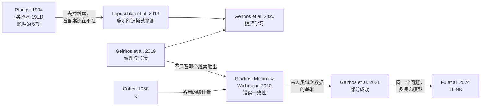

[English](part1-people-next-to-machine.md) · **中文**

# 第 1 部分 · 一个人：机器旁边的人

*答对了，理由也对吗？检验：**比错误，不只比分数**。*

## 讲座里讲了什么

**心理学早就知道的。** 聪明的汉斯是一匹看起来会数数的马。检验它时只改了一个条件：提问者知不知道答案？提问者知道时，汉斯的正确率是 98%；提问者不知道时，只有 8%。汉斯读的是提问者头部细微的、无意的动作，而不是在做算术。看起来像某种能力的行为，还不能证明它真的具备这种能力；受控比较才能。

**AI 领域的经典工作。** AI 也有自己的聪明的汉斯。Sebastian Lapuschkin 等人发现，有个模型认马靠的是照片上的来源标签，而不是马本身。图宾根的 Robert Geirhos 等人发现，用 ImageNet（一个大型的带标签照片集）训练的网络，会把长着大象皮的猫认成大象：它们看纹理，人看形状。Geirhos 等人给这类问题起了个总的名字，叫捷径学习：在训练中管用的线索，却不是我们想要的能力。分数看起来没问题时，怎样抓住捷径？比错误：分数相同的两个系统，可能错在不同的图片上。Geirhos 等人用 Cohen's κ 衡量各自错在哪些图片上。在一批图片上，人与人之间是 0.33，网络与人之间只有 0.07。后来，最好的模型在准确率上赶上了人，错误却仍然和人不同。

**讲者团队做了什么。** 以人为参照做跟踪。跟踪是指在一段视频里跟住同一个物体，即使它暂时看不见了。先是一个更难、更像人的任务：镜头一切，目标消失，又在别的地方出现。在这个任务上，人比二十种跟踪算法做得都好。团队人机研究里的一段视频显示了差别所在：在一群长得很像的火烈鸟里，人一直跟着同一只；一个最先进的算法却跳到了另一只长得像的鸟上。人跟住的是原来的目标，算法依赖的是外观。然后，团队按人怎样把目标找回来，造了一个跟踪器 CPDTrack。宽而粗的周边视觉决定往哪里看，窄而细的中央视觉确认那里是什么。五个人和 18 种算法跟踪了同样的 16 段视频。人得了 0.94，CPDTrack 得了 0.85，在 18 种算法中排第一。但它和人的错误一致性只有 0.17（0 表示偶然水平，1 表示错误完全相同）。它能把目标重新找回来，但它出错的时刻仍然和人不同。

*讲座第 16 页：分数相近，错误不同。*

## 背后的问题

**答对了，理由也对吗？** 还没有：分数相近，错误不同。分数相近，不等于过程相近。把模型和人比较时，不仅要比各自错了多少，还要比错在**哪些**题上；还要把你怀疑的线索和你本来想考的线索放到冲突里。用心理学的话说，这就是受控比较。人类参照是人与人之间的分布范围，而不是 100% 的上限。

**要检验理由，就比错误，不只比分数。**

## 反过来，对心理学有什么用

这些检验也让我们更了解人；在这一部分，是关于人怎样看。但照人类视觉理论造出的模型，本身并不能检验这个理论。从跟踪器里拿掉一个部件，说明的是模型需要什么，而不是人怎样看。中央视觉和周边视觉的分工在人身上是否成立，要回到人身上去检验：例如遮住中央视觉或周边视觉，看同类的错误会不会增多。讲座把这留作一个悬而未决的问题：模型的部件，会像人的一样出错吗？

## 重点必读

先读这五篇。下面每篇都说明做了什么、发现了什么、对这一部分的问题意味着什么，以及它没有表明什么；方法的细节和数据在哪里，见各自的卡片。

### 1. [长着大象皮的猫：用 ImageNet 训练的网络看纹理，人看形状](../resources/examples/geirhos2019-texture-bias.zh.md)

Geirhos et al., 2019, *ICLR*

**做了什么。** 采用线索冲突设计，这是知觉研究判断观察者使用两种线索中哪一种的标准做法。风格迁移（一种用另一张图像的纹理重画一张图像的方法）让每张图像具有某一类别的形状和另一类别的纹理，人和网络对同一批图像分类。人类数据来自实验室心理物理学研究：九项实验，48,560 个试次，97 名观察者。

**发现了什么。** 用 ImageNet（一个大型的带标签照片集）训练的网络强烈偏好纹理，而人依据形状做判断。同一种网络结构（ResNet-50，一种常用的图像网络）如果在纹理被替换掉的 *Stylized-ImageNet* 上训练，就会转而学到基于形状的表征，与人类行为更吻合，对图像失真也更稳健。

**对这一部分意味着什么。** 这就是讲座里那只长着大象皮的猫，也是这一部分问题最直白的形式：把怀疑的线索和本来想考的线索放到冲突里，看哪一种胜出，对人和机器都是如此。答案还取决于训练数据，而不只取决于架构。

**它没有表明什么。** 形状与纹理只是众多线索维度中的一个。人和模型可能在哪种线索胜出上一致，却仍然错在不同的图像上；第 2 篇衡量的正是这一点。

### 2. [分数相近，错误不同：错误一致性](../resources/examples/geirhos2020-error-consistency.zh.md)

Geirhos, Meding & Wichmann, 2020, *NeurIPS*

**做了什么。** 对每个试次，记录每个决策者是对还是错，再看两者在同一批试次上一起出错有多频繁，并和偶然水平比较：按两者各自的准确率，纯属偶然时会有多少次一起出错。这个指标就是用在对错上的 Cohen's κ，一个来自心理测量的统计量，可用于模型与模型、人与人、模型与人之间的比较。

**发现了什么。** 在物体识别上，任何架构的网络彼此之间都高度一致，但它们与人类观察者的一致性只略高于偶然水平。CORnet-S 是一个模拟大脑物体识别通路的模型，内部有把信号送回去的回路（循环模型）；在这里，它的表现与信号只朝一个方向传的标准图像网络（前馈的 ResNet-50）基本相同。

**对这一部分意味着什么。** 这正是这一部分检验的原样：比各自错在哪些题上，而不只比错了多少。它比第 1 篇更进一步，从哪种线索胜出，走到错误是否落在同样的图像上，并把“模型像人一样处理图像”变成一个可能失败的检验。

**它没有表明什么。** 一致的错误是共享策略的必要条件，但不是充分条件；仅凭 κ 低也无法确定模型用的是哪条捷径。解读 κ 时要以人与人之间的一致性为参照，而不是以理想值 1 为参照。

### 3. [在错误的地方找到正确答案：聪明的汉斯式预测器](../resources/examples/lapuschkin2019-clever-hans.zh.md)

Lapuschkin et al., 2019, *Nature Communications*

**做了什么。** 解释方法显示模型依赖了输入的哪些部分，论文提出的谱相关分析（Spectral Relevance Analysis，SpRAy）把大量输入上的解释图归并成组，这样看到的是整体的策略，而不只是单个案例。决定性的检验与 Oskar Pfungst 在 1904 年对聪明的汉斯所用的检验相同：去掉可疑的线索，看答案是否还在；再把它加到不该出现的地方，看答案是否跟着走。

**发现了什么。** 一个在公开照片集 PASCAL VOC 2007 上训练的图像分类器（Fisher 向量分类器，一种深度学习之前的较老方法），靠一个来源标签识别马，这个标签出现在大约五分之一的马图像中。去掉标签，“马”的分类就消失了；把标签加到一张汽车图像上，这张图像的分类随之改变。

**对这一部分意味着什么。** 这就是讲座里 AI 自己的聪明的汉斯，它的逻辑来自心理学：去掉线索的操纵就是一个控制条件。Geirhos 等人后来把这类问题统称为捷径学习。第 2 篇能显示模型与人不同；这篇则展示怎样确定模型实际用的是哪条线索。

**它没有表明什么。** 解释图本身也是测量，需要单独的效度检验：它只说明模型看了哪里，而不说明为什么。正是去除与插入检验让结论令人信服。

### 4. [部分成功：稳健性差距在缩小，一致性差距没有](../resources/examples/geirhos2021-partial-success.zh.md)

Geirhos et al., 2021, *NeurIPS*

**做了什么。** 人接受了一批分布外数据集的测试，也就是和模型训练时见过的图像不一样的图像，例如加噪、风格化或只保留边缘的图像：90 名被试，共 85,120 个心理物理学试次。所选模型与用带标签照片训练的标准网络不同：训练它们去做的事不同，结构不同，学过的图像数量也不同（100 万到 10 亿张），每个模型都在准确率和图像层面的错误一致性上与人比较。

**发现了什么。** 稳健性差距正在缩小：在大多数数据集上，最好的模型现在已超过人在短暂呈现条件下的表现。图像层面仍有相当大的一致性差距，大多数模型在错误上彼此一致。在许多情况下，当训练集扩大到原来的 10 到 1,000 倍时，与人的一致性会提高。

**对这一部分意味着什么。** 这就是讲座里说的：后来，最好的模型在准确率上赶上了人，错误却仍然和人不同。它说明为什么准确率和错误一致性必须分开报告：一个模型是否“更像人”，取决于你测的是哪一个。人类试次数据是公开的。

**它没有表明什么。** 人类数据来自对单张图像的短暂呈现，因此描述的是快速识别，而不是人类视觉的全部。结果描述的是 2021 年测试的模型。

### 5. [看见了，却没有知觉到：BLINK](../resources/examples/fu2024-blink.zh.md)

Fu et al., 2024, *ECCV*（BLINK）

**做了什么。** 十四项经典计算机视觉任务，例如相对深度、视觉对应和伪造检测，被改写成 3,807 道包含一张或多张图像的多项选择题，交给多模态语言模型（既能看图像、也能读文字的聊天模型）回答。人在同样题目上的准确率作为基线；随机猜测提供第二个参照点。

**发现了什么。** 人的平均准确率为 95.70%。当时最好的模型 GPT-4V 和 Gemini 分别为 51.26% 和 45.72%，只比随机猜测高 13.17 和 7.63 个百分点。专门的计算机视觉模型要好得多。

**对这一部分意味着什么。** 这项研究讲座里没有展示，它把这一部分的问题从图像分类器带到如今大多数人使用的聊天式模型上：流利的回答可能掩盖薄弱的知觉。最后读它，看这个问题今天延伸到了哪里。

**它没有表明什么。** 它只比较准确率，没有比较人和模型在哪些题目上出错，而这正是第 2 篇能补上的一步。结果描述的是 2024 年测试的模型；更新的模型应该重新测试。

## 它们之间的关系

这几篇文献贯穿着三条主线。

- **线索。** Pfungst 在 1904 年证明，聪明的汉斯是根据提问者头部细微的、无意的动作作答的：他去掉这个线索，答案就不灵了。[Lapuschkin 等](../resources/examples/lapuschkin2019-clever-hans.zh.md)把同样的逻辑用到了分类器上。Geirhos 等（2020，*Shortcut learning in deep neural networks*，[doi](https://doi.org/10.1038/s42256-020-00257-z)）给出了一个总的名字：捷径是指在标准基准上管用、在更难的测试条件下却失灵的决策规则。这篇论文还指出，比较心理学、教育学和语言学里早就有类似的问题。
- **测量。** [纹理偏好研究](../resources/examples/geirhos2019-texture-bias.zh.md)问的是两个线索里哪个胜出。[错误一致性](../resources/examples/geirhos2020-error-consistency.zh.md)更进一步：人和模型是不是错在*同样*的图片上？它借用了心理测量中的统计量 Cohen's κ。[部分成功](../resources/examples/geirhos2021-partial-success.zh.md)把两者都用到许多更新的模型上，并公开了人类的试次数据。
- **范围。** 同样的比较如今已经用到了多模态语言模型上。[BLINK](../resources/examples/fu2024-blink.zh.md) 报告的是相对于人类基线的正确率；它还没有报告人和模型分别错在哪些题上，这正是自然的下一步。

**悬而未决的问题。** *部分成功*发现，模型在稳健性上已经追上甚至超过了人，错的却仍是不同的图片。一个模型是否“更像人”，取决于你测的是这两者中的哪一个，所以两者都要报告。

## 更大的版图

[全领域文献清单](../resources/literature.md#part-1--one-person-people-next-to-the-machine)（英文）为这一部分收录了 101 篇核实过的参考文献，分组如下。

| 分组 | 涵盖内容 | 条目数 |
|---|---|---|
| [视觉中的人机比较](../resources/literature.md#humanmachine-comparison-in-vision) | 网络和人共同参与的心理物理学：退化图像和线索冲突图像、灵长类行为、稳健性 | 17 |
| [大语言模型和视觉–语言模型做认知心理学任务](../resources/literature.md#llmsvlms-on-cognitive-psychology-tasks-and-batteries-incl-critiques) | 交给语言模型和视觉–语言模型的经典任务与成套测验，以及对这种做法的批评 | 29 |
| [过程与证据的评测](../resources/literature.md#process-and-evidence-evaluation-grounding-gaze-stepwisecausal-reasoning-calibration) | 对的答案是否建立在对的证据上：证据定位、注视、逐步推理与因果推理、校准 | 14 |
| [把 AI 当作心智和大脑的模型](../resources/literature.md#ai-as-models-of-the-mind-and-brain-incl-critiques) | 把网络当作人类认知和神经数据的模型，以及相关批评 | 13 |
| [以认知理论指导模型设计](../resources/literature.md#cognitive-theory-guided-model-design-evaluated-against-people) | 依据人类知觉或认知理论构建、再与人对照检验的模型 | 13 |
| [带逐题人类数据的基准和数据集](../resources/literature.md#benchmarks-and-datasets-with-trial-level-or-item-level-human-data) | 到哪里找逐题的人类反应数据，以及获取方式和许可 | 15 |

按心理学分支的阅读，见[给心理学学生的清单](../resources/students.md#cognitive-psychology-and-neuroscience)（英文）。

## 讲座里讲者团队自己的研究

讲者团队的研究，只列公开版本（\* 为共同第一作者）。建议读完重点必读再看；讲座里我们自己的例子都出自这里。

- **任务：跨镜头跟住同一个目标，人和二十个算法一起测。** Hu, S., Zhao, X., Huang, L., & Huang, K. (2023). Global instance tracking: Locating target more like humans. *IEEE TPAMI*, 45(1), 576–592. [doi](https://doi.org/10.1109/TPAMI.2022.3153312)
- **同一个任务，加上语言和长视频。** Hu, S., Zhang, D., Wu, M., Feng, X., Li, X., Zhao, X., & Huang, K. (2023). A multi-modal global instance tracking benchmark (MGIT): Better locating target in complex spatio-temporal and causal relationship. *NeurIPS 2023, Datasets and Benchmarks*. [doi](https://doi.org/10.52202/075280-1087)
- **按人怎样把目标找回来造出的跟踪器（CPDTrack），以及它和人的错误比较。** Zhang, D., Hu, S., Feng, X., Li, X., Wu, M., Zhang, J., & Huang, K. (2024). Beyond accuracy: Tracking more like human via visual search. *NeurIPS 2024*. [doi](https://doi.org/10.52202/079017-0086)
- **人机跟踪研究：火烈鸟那段视频，以及人是一个范围。** Zhao, X., Hu, S., & Yin, X.-C. (2025). *Visual object tracking: An evaluation perspective*. Springer. [doi](https://doi.org/10.1007/978-981-96-4558-9)
- **3E 范式的出处。** Hu, S., Zhao, X., & Huang, K. (2024). SOTVerse: A user-defined task space of single object tracking. *International Journal of Computer Vision*, 132(3), 872–930. [doi](https://doi.org/10.1007/s11263-023-01908-5)

## 术语

[线索](glossary.zh.md#线索cue) · [线索冲突](glossary.zh.md#线索冲突cue-conflict) · [形状偏好](glossary.zh.md#形状偏好shape-bias) · [错误一致性](glossary.zh.md#错误一致性error-consistency) · [Cohen's κ](glossary.zh.md#cohens-kappa) · [聪明的汉斯效应](glossary.zh.md#聪明的汉斯效应clever-hans-effect) · [捷径学习](glossary.zh.md#捷径学习shortcut-learning) · [人类基线](glossary.zh.md#人类基线human-baseline) · [分布外数据](glossary.zh.md#分布外数据out-of-distribution-data) · [心理物理学](glossary.zh.md#心理物理学psychophysics) · [解释方法](glossary.zh.md#解释方法explanation-method)

## 一起做

[两个领域在哪里相遇，第 1 个问题](../resources/working-together.zh.md#1-答对了理由也对吗)：两边各带来什么、先读什么，以及可以借鉴的已发表研究。

---

下一部分：[第 2 部分 · 一群人：人作为答案](part2-people-as-the-answer.zh.md) · 回到[开始页](start-here.zh.md)
