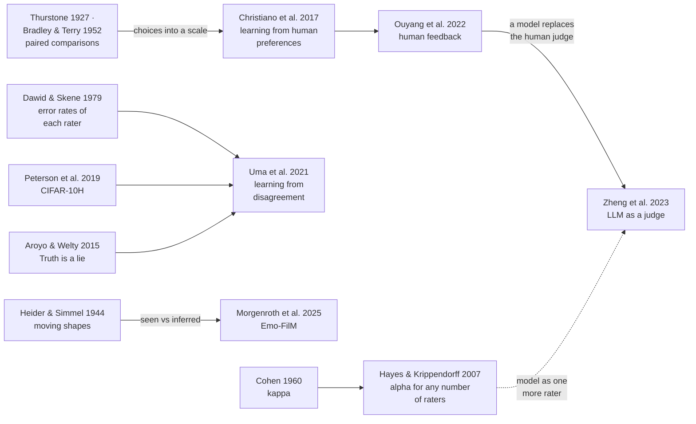

**English** · [中文](part2-people-as-the-answer.zh.md)

# Part 2 · A group: people as the answer

*Whose standard does it follow? The check: **compare with a group, not one person**.*

## What the talk showed

**What psychology already knew.** Shown moving shapes, people read intentions into them, and each reads them a little differently: people are not one ruler but a spread. And Thurstone showed in 1927 how to turn many people's choices between pairs into one scale.

**The classic work in AI.** ChatGPT learned what people prefer in the same way. In 2020, GPT-3 had 175 billion parameters (the numbers a model adjusts as it learns). Size alone did not give answers people liked. For InstructGPT, people ranked several answers to the same prompt, and each ranking was split into pairs. A scoring model (a "reward model") was trained on the pairs, and the chat model learned to score well on it. People then preferred the answers of a 1.3-billion-parameter InstructGPT model, more than a hundred times smaller than GPT-3. Months later, ChatGPT was trained with the same kind of human feedback. Chatbots are ranked from people's paired votes too. But the rankings came from about 40 labellers (raters, in psychology's terms), and they agreed with each other only about 73% of the time. Whose preferences did it learn?

**What the speaker's group built.** Describing videos, with people as the reference, one step harder at a time. MGIT describes each long video at three levels: an action, an activity, a story. CausalStep asks why each step happened. Describing comes close to people: 92.0% right for people, 85.2% for the best model. Explaining why does not: 76.8% for people, 39.8% for the best model, about half. FIOVA has five people describe each of 3,002 clips. In one, a child on a balance bike falls. All five agree that he ends up on the ground. They do not agree on what it means: one says he is pretending, others that he cries or smiles. An AI model picked one reading, crying, and stated it as a fact. So all five descriptions are kept, and a model is scored against the group, event by event. An event weighs more the more the five stress it; that is agreement among viewers, not proof that it happened. One model's description covered about a third of the weight.

## The question behind it

**Whose standard does it follow?** A group of people, not one person. Preference training ends in one reward score; an evaluation can keep the spread. One label, or a majority vote, hides how much people disagree. Treat the model as one more rater: does it agree with people as well as they agree with each other, and does it keep their disagreement or flatten it? In psychology's terms: inter-rater reliability, with the spread among raters as part of the data.

**To check the standard, compare with a group, not one person.**

## What it gives back to psychology

Psychologists now use language models to code answers and rate material. You already check human raters by how much they agree; keep how they differ, too. Before a model codes or rates for you, check it against the spread of a group, not against one answer key. The speaker's video data show why. On the clips where the five people differed most, all six models scored lower. The models also looked more alike: how much a clip's rank varied across the six models fell from 0.577 on the clips where people agreed most to 0.444 on the 169 clips where they differed most, almost a quarter less. Where people spread out, the models moved closer together. The group's guess, not yet tested: on an unclear scene, people bring their own readings, while models fall back on one typical reading. And the data run the other way as well: thousands of clips with five readings each show where and how people's readings of an event differ.

*Slide 28 of the talk: people's spread, models' spread.*

## Key readings

Read these five first. Each one below says what was done, what was found, what it means for this part's question, and what it does not show; its card gives the method in full and where the data are.

### 1. [People read intentions into moving shapes](../resources/examples/heider1944-moving-shapes.md)

Heider & Simmel, 1944, *American Journal of Psychology*

**What they did.** A film of about two and a half minutes showed three geometric figures moving in and around a rectangle with a door. Three groups of undergraduate women, 114 in all, watched it twice: one was only asked to write down what happened, one to interpret the movements as actions of persons, and one saw the film in reverse.

**What they found.** Almost every participant described the film as actions of animated beings, mostly persons. Some readings were almost uniform: every participant saw the figures pushing or pulling the door, forwards or in reverse. Readings of motives and causes varied much more, especially for the reversed film.

**What it means here.** This is the classic behind the talk's moving shapes: observers agree on actions and diverge on meanings. The five people who describe the child falling off a balance bike show the same split between seen and inferred, and reading 4 finds it in emotion ratings. The spread of a group belongs in the reference, and it is widest on what is inferred.

**What it does not show.** The participants were 114 undergraduate women in the 1940s, and the study reports descriptions and their themes, not a modern agreement statistic.

### 2. [A chat model's training rests on people's comparisons](../resources/examples/ouyang2022-human-feedback.md)

Ouyang et al., 2022, *NeurIPS*

**What they did.** Labellers (raters, in psychology's terms) wrote demonstrations of the desired behaviour for a set of prompts, and GPT-3 was fine-tuned on them, that is, trained a little further on these examples. Labellers then ranked several outputs for the same prompt. The rankings trained a reward model, the scoring model that gives each answer one score. The language model was then trained to raise that score, a method called reinforcement learning from human feedback (RLHF). The resulting InstructGPT models were evaluated by asking people which outputs they preferred.

**What they found.** On the authors' prompts, people preferred a 1.3-billion-parameter InstructGPT model to the 175-billion-parameter GPT-3, which has over 100 times more parameters (the numbers a model adjusts as it learns). The labellers who made the training data agreed with each other about 73% of the time (72.6 ± 1.5%).

**What it means here.** This is the talk's classic work in AI: the reference behind today's chat models is a group of people making comparisons, and they disagree about a quarter of the time. Training ends in one score from the reward model, so their spread is not kept. Whose judgements count, and what happens to their disagreement, is a measurement question.

**What it does not show.** The model is aligned to, that is, made to follow, one particular group, the authors' labellers, mostly English-speaking people living in the United States or Southeast Asia, and to the researchers' own instructions; not to people in general.

### 3. [About fifty people per image: CIFAR-10H](../resources/examples/peterson2019-cifar10h.md)

Peterson et al., 2019, *ICCV* (CIFAR-10H)

**What they did.** People categorised every image in the CIFAR-10 test set, 10,000 small images in ten classes. In all, 2,571 participants on Amazon Mechanical Turk each categorised 200 images, with an attention check every 20 trials. Classifiers were then compared with the resulting label distributions and also trained on them.

**What they found.** The 511,400 human decisions, about 50 per image, give a full distribution of labels for each image. Classifiers trained in the usual way do not show human-like uncertainty. Training on the human distributions closes this gap. The models then do better on test images increasingly unlike their training images, and are harder to fool with adversarial attacks (images changed slightly on purpose to make a model err).

**What it means here.** Not shown in the talk. It turns disagreement from noise into data: the same image can be a cat to most people and a dog to some. It is the simplest case of this part's check, a group rather than one label, and it shows that the comparison changes what a model learns. Read it before reading 5, which surveys its research area.

**What it does not show.** The images are tiny and the ten categories simple, and crowd workers on one platform are one particular human reference.

### 4. [Forty-four raters, fourteen films: Emo-FilM](../resources/examples/morgenroth2025-emo-film.md)

Morgenroth et al., 2025, *Scientific Data* (Emo-FilM)

**What they did.** Forty-four raters annotated 14 short films, more than two and a half hours in total, on 50 items: discrete emotions, plus components of emotion from appraisal, motivation, motor expression, physiological response and feeling. A separate sample of 30 people watched the same films during functional MRI, with heart rate, respiration and electrodermal activity recorded.

**What they found.** The ratings had a mean inter-rater agreement of 0.38: moderate at best, although every rater saw the same films.

**What it means here.** Not shown in the talk. This is Heider and Simmel's split in modern emotion ratings: when raters judge feelings, agreement is only moderate. A model that rates emotion in these films should be judged against this spread, not against one rater or the average rater. As this part's open question puts it, at 0.38 "agreeing with the human label" is not a well-defined target.

**What it does not show.** The data were designed for affective neuroscience, and 0.38 is a mean: agreement on single items and moments can be higher or lower.

### 5. [When people disagree, learn from the disagreement](../resources/examples/uma2021-learning-from-disagreement.md)

Uma et al., 2021, *JAIR*

**What they did.** A survey with its own experiments. It reviews the evidence for disagreement in language and vision tasks, from objective ones such as part-of-speech tagging (marking each word as a noun, verb and so on) to subjective ones, then trains the most common approaches on every available data set with multiple judgements per item.

**What they found.** The ranking of training methods depends on the evaluation chosen, so the field must agree on how to evaluate even without a single gold standard. Soft labels keep the share of people who chose each answer; a gold label keeps one answer. With many judgements by high-quality coders for each item, training directly on soft labels beat training on combined or even gold labels. This held both when models were scored against one answer (hard evaluation) and against the spread of answers (soft evaluation). Otherwise, combining gold and soft labels generally did best in hard evaluation.

**What it means here.** Not shown in the talk. It is the entry point to the research area that treats the spread among people as information, and a map of its data sets. It answers this part's question from the side of machine learning: one label, or a majority vote, hides how much people disagree. Read it after reading 3.

**What it does not show.** It covers language and vision tasks up to 2021; large language models as raters came later (see [the wider landscape](#the-wider-landscape)).

## How they connect

Four threads run through these readings.

- **Agreement as measurement.** Psychology has long measured how far raters agree: Cohen's κ for two raters and categories (1960), and Krippendorff's α for any number of raters and kinds of data (Hayes & Krippendorff, 2007, [doi](https://doi.org/10.1080/19312450709336664)). The habit in this part treats a model as one more rater and asks whether it agrees with people as well as they agree with each other.
- **Disagreement as data.** Dawid and Skene (1979, [doi](https://doi.org/10.2307/2346806)) estimated each observer's error rates instead of trusting a majority. Aroyo and Welty (2015, *Truth is a lie*, [doi](https://doi.org/10.1609/aimag.v36i1.2564)) argued that there is often no single true label to recover. [CIFAR-10H](../resources/examples/peterson2019-cifar10h.md) collected the full human distribution for an image data set, and [Uma et al.](../resources/examples/uma2021-learning-from-disagreement.md) brought the field together.
- **Seen and inferred.** [Heider and Simmel](../resources/examples/heider1944-moving-shapes.md) found near-uniform readings of actions and varied readings of motives. [Emo-FilM](../resources/examples/morgenroth2025-emo-film.md) shows the same pattern in modern emotion ratings: agreement is only moderate when raters judge feelings.
- **Human judgement as training signal, and its replacement.** Thurstone turned people's choices between pairs into a scale (1927, *Psychological Review*, [doi](https://doi.org/10.1037/h0070288)); Bradley and Terry gave the model that today's reward models use (1952, *Biometrika*, [doi](https://doi.org/10.2307/2334029)). Learning from human preferences (Christiano et al., 2017, [NeurIPS](https://papers.nips.cc/paper/2017/hash/d5e2c0adad503c91f91df240d0cd4e49-Abstract.html)) became the training method behind [InstructGPT](../resources/examples/ouyang2022-human-feedback.md). Language models are now used as judges in place of people. Zheng et al. (2023, *Judging LLM-as-a-judge*, [doi](https://doi.org/10.52202/075280-2020)) report over 80% agreement between GPT-4 and human preferences, the same level as between humans, and also position, verbosity and self-enhancement biases.

**The open question.** If people agree only 73% of the time on which answer is better, or at 0.38 on emotion, then "agreeing with the human label" is not a well-defined target. A model that agrees with the majority more than any person does may have *flattened* the disagreement rather than matched it. Report the model's agreement against the range of agreement among people, and whether it keeps their spread.

## The wider landscape

The [field-wide list](../resources/literature.md#part-2--a-group-people-as-the-answer) has 102 checked references for this part, grouped as follows.

| Group | What it covers | Entries |
|---|---|---|
| [LLMs as annotators and coders](../resources/literature.md#llms-as-annotators--coders-of-psychological-and-social-science-constructs) | language models labelling text for psychology and the social sciences, and how to validate them (also in [Part 4](part4-ai-in-your-research.md)) | 15 |
| [Human label variation and perspectivism](../resources/literature.md#human-label-variation-annotator-disagreement-and-perspectivism) | why people disagree, and how to learn from and evaluate against disagreement | 15 |
| [Machine description against several human describers](../resources/literature.md#machine-description-of-people-and-scenes-vs-multiple-human-describers) | captions and descriptions of images, video and people, compared with many human descriptions | 12 |
| [LLM-as-judge and verifiers](../resources/literature.md#llm-as-judge-and-verifiers-agreement-with-humans-biases-meta-evaluation) | models that grade other models' answers: agreement with people, biases, how to evaluate the judges | 21 |
| [Behaviour sensing and machine-read assessment](../resources/literature.md#behaviour-sensing-and-machine-read-psychological-assessment-with-validity-critiques) | reading faces, voices, text and behaviour for psychological states, with critiques of validity | 16 |
| [Data sets with several annotators per item](../resources/literature.md#datasets-with-several-human-annotators-per-item) | where to find multiple human judgements per item, with access and licence | 23 |

For readings by area of psychology, see [measurement and psychometrics](../resources/students.md#measurement-and-psychometrics) and [emotion and affective science](../resources/students.md#emotion-and-affective-science) in the list for psychology students.

## The talk's own studies

The speaker's group, in their public versions (\* equal contribution). Read them after the key readings; they are where the talk's own examples come from.

- **Describing each long video at three levels: an action, an activity, a story.** Hu, S., Zhang, D., Wu, M., Feng, X., Li, X., Zhao, X., & Huang, K. (2023). A multi-modal global instance tracking benchmark (MGIT): Better locating target in complex spatio-temporal and causal relationship. *NeurIPS 2023, Datasets and Benchmarks*. [doi](https://doi.org/10.52202/075280-1087)
- **Asking why each step happened.** Li, X.\*, Li, X.\*, Hu, S., Huang, K., & Zhang, W. (2026). CausalStep: A benchmark for explicit stepwise causal reasoning in videos. *AAAI 2026*, 40(8), 6530–6538. [doi](https://doi.org/10.1609/aaai.v40i8.37582)
- **Five people describe each video, and a model is scored against all five.** Hu, S.\*, Li, X.\*, Li, X., Zhang, J., Wang, Y., Zhao, X., & Cheong, K. H. FIOVA: A multi-annotator benchmark for human-aligned video captioning. [arXiv:2410.15270](https://arxiv.org/abs/2410.15270)

## Terms

[Reference](glossary.md#reference) · [Inter-rater reliability](glossary.md#inter-rater-reliability) · [Krippendorff's α](glossary.md#krippendorffs-alpha) · [Gold label and majority vote](glossary.md#gold-label-and-majority-vote) · [Label distribution](glossary.md#label-distribution) · [Human label variation](glossary.md#human-label-variation) · [Perspectivism](glossary.md#perspectivism) · [Seen and inferred](glossary.md#seen-and-inferred) · [Rater model](glossary.md#rater-model) · [Learning from human feedback](glossary.md#learning-from-human-feedback) · [LLM as a judge](glossary.md#llm-as-a-judge)

## Work on it together

[Where the two fields meet, question 2](../resources/working-together.md#2-whose-standard-does-it-follow): what each side brings, what to read first, and published studies to learn from.

---

Next: [Part 3 · A society: people we make](part3-people-we-make.md) · Previous: [Part 1 · One person: people next to the machine](part1-people-next-to-machine.md) · Back to the [start page](start-here.md)
