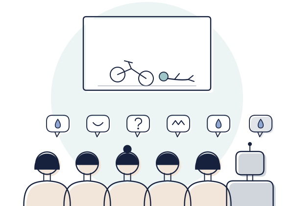
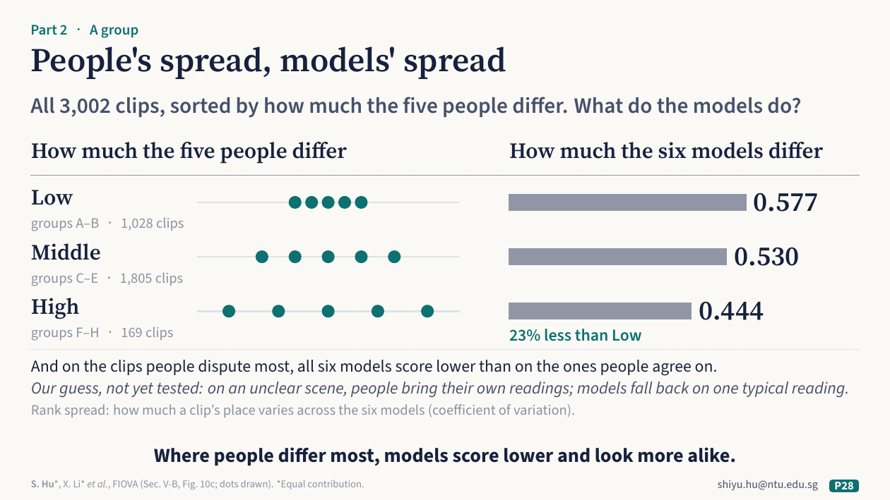
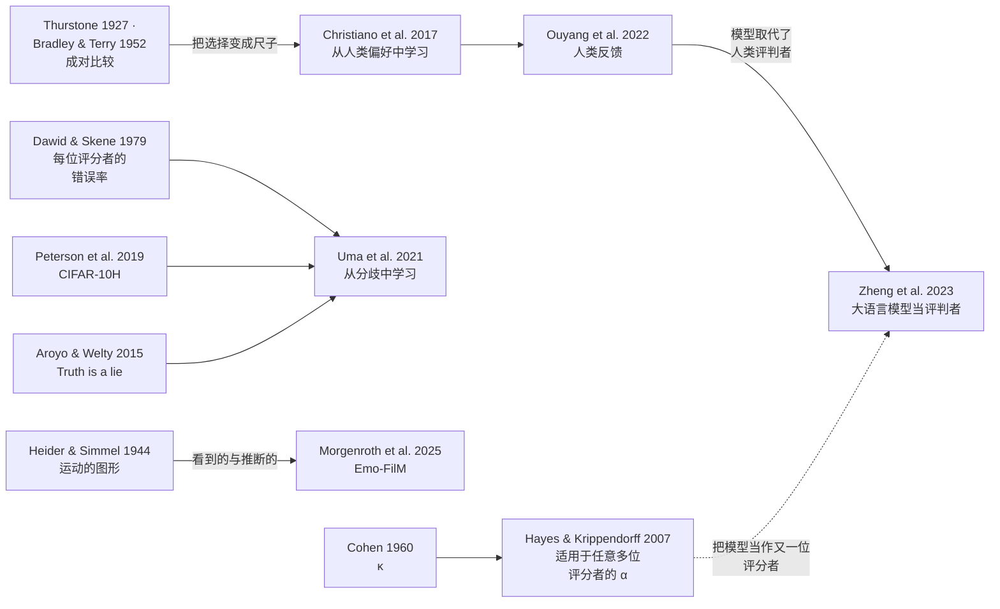

[English](part2-people-as-the-answer.md) · **中文**

# 第 2 部分 · 一群人：人作为答案

*它遵循谁的标准？检验：**拿一群人比，不拿一个人比**。*

## 讲座里讲了什么

**心理学早就知道的。** 给人看移动的图形，人会从中读出意图，而且每个人读得都不太一样：人不是一把尺子，而是一个分布。Thurstone 在 1927 年给出了办法，把很多人在一对对选项之间的选择，变成一把尺子。

**AI 领域的经典工作。** ChatGPT 就是这样学会人的偏好的。2020 年，GPT-3 有 1750 亿个参数（模型在学习中调整的那些数值）。光靠规模，并不能给出人们喜欢的回答。做 InstructGPT 时，人给同一个提示词的几个回答排序，每个排序拆成一对一对的比较。用这些比较训练一个打分模型（“奖励模型”），聊天模型再学着在这个打分模型上拿高分。之后，人们更喜欢 13 亿参数的 InstructGPT 模型给出的回答，它比 GPT-3 小了一百多倍。几个月后，ChatGPT 也用同一类人类反馈来训练。聊天机器人的排行榜，也来自人一对一对的投票。可是这些排序出自大约 40 名标注员（也就是心理学说的评分者），他们彼此只有约 73% 的时候意见一致。它学到的，是谁的偏好？

**讲者团队做了什么。** 以人为参照做视频描述，一步比一步难。MGIT 把每段长视频描述成三个层次：一个动作、一段活动、一个故事。CausalStep 追问每一步为什么发生。描述接近人：人答对 92.0%，最好的模型答对 85.2%。解释为什么却差得远：人答对 76.8%，最好的模型只有 39.8%，大约是人的一半。FIOVA 请五个人分别描述 3,002 段视频中的每一段。其中一段里，一个骑平衡车的孩子摔倒了。五个人都同意，他最后倒在了地上。这意味着什么，他们却说法不一：有一个人说他在装，有人说在哭，也有人说在笑。一个 AI 模型选了其中一种读法，“在哭”，并把它当成事实说了出来。所以五份描述全部保留，逐个事件地把模型和这一群人比较。五份描述越看重一个事件，它的权重就越高；这说明的是观看者之间的一致，而不是这件事一定发生了。有一个模型的描述，覆盖了总权重的大约三分之一。

## 背后的问题

**它遵循谁的标准？** 一群人，而不是一个人。偏好训练最后只剩一个奖励分数；评测却可以把分布留下来。一个标签或一次多数投票，会掩盖人们之间有多大分歧。把模型当作又一位评分者：它和人的一致程度，是否达到人与人之间的一致程度？它保留了人们之间的分歧，还是把分歧抹平了？用心理学的话说，这就是评分者信度，而评分者之间的分布本身也是数据。

**要检验标准，就拿一群人比，不拿一个人比。**

## 反过来，对心理学有什么用

心理学家现在开始用语言模型给回答编码、给材料打分。你本来就用一致程度来检验人类评分者；也请把他们之间的差异留下来。在模型替你编码或打分之前，先拿一群人的分布来检验它，而不是拿一份标准答案。讲者的视频数据说明了原因。在五个人分歧最大的视频上，六个模型的得分都更低。模型之间也更像了：一段视频在六个模型里的排名有多分散，在人们最一致的视频上是 0.577，在分歧最大的 169 段视频上是 0.444，小了将近四分之一。人越分散，模型反而越靠拢。团队的猜测，还没有验证：场景不清楚时，每个人会带入自己的理解，而模型都退回到同一种最典型的理解。数据也可以反过来用：几千段视频、每段五种读法，能看出人对一件事的解读在哪里、怎样不同。

*讲座第 28 页：人的分散，模型的分散。*

## 重点必读

先读这五篇。下面每篇都说明做了什么、发现了什么、对这一部分的问题意味着什么，以及它没有表明什么；方法的细节和数据在哪里，见各自的卡片。

### 1. [人会从移动的图形里读出意图](../resources/examples/heider1944-moving-shapes.zh.md)

Heider & Simmel, 1944, *American Journal of Psychology*

**做了什么。** 一段约两分半钟的影片显示三个几何图形在一个带门的长方形内外移动。三组女大学生共 114 人，各看了两遍：一组只被要求写下发生了什么，一组被要求把这些运动解读为人的行动，一组看的是倒放的影片。

**发现了什么。** 几乎每个被试都把影片描述为有生命的存在的行动，大多是人的行动。有些解读几乎完全一致：无论正放还是倒放，每个被试都看到图形在推门或拉门。对动机和原因的解读差异大得多，倒放影片尤其如此。

**对这一部分意味着什么。** 这是讲座里运动图形背后的经典研究：观察者在动作上一致，在意义上分歧。描述孩子从平衡车上摔下来的五个人，显出的也是这种“看到的”与“推断的”之分；第 4 篇则在情绪评分里看到了它。一群人的分布应当放进参照里，而分布在推断的部分最宽。

**它没有表明什么。** 被试是 1940 年代的 114 名女大学生，研究报告的是描述及其主题，而不是现代的一致性统计量。

### 2. [聊天模型的训练建立在人的比较之上](../resources/examples/ouyang2022-human-feedback.zh.md)

Ouyang et al., 2022, *NeurIPS*

**做了什么。** 标注员（也就是心理学说的评分者）为一组提示词写出期望的回答作为示范，再用这些示范对 GPT-3 做微调，也就是拿这些例子把它再训练一下。随后，标注员给同一提示词的多个输出排序。这些排序用来训练一个奖励模型，也就是给每个回答打一个分数的打分模型。再训练语言模型去提高这个分数，这种方法叫基于人类反馈的强化学习（RLHF）。由此得到的 InstructGPT 模型，用询问人们更喜欢哪些输出的方式来评估。

**发现了什么。** 在作者的提示词上，人们更喜欢 13 亿参数的 InstructGPT 模型，而不是 1750 亿参数的 GPT-3，后者的参数是前者的一百多倍（参数是模型在学习中调整的那些数值）。制作训练数据的标注员彼此一致的比例约为 73%（72.6 ± 1.5%）。

**对这一部分意味着什么。** 这是讲座里 AI 领域的经典工作：当今聊天模型背后的参照是一群做比较的人，而他们大约四分之一的时候意见不一致。训练最后只剩奖励模型给的一个分数，所以他们之间的分布没有留下来。用谁的判断、怎样处理他们的分歧，是一个测量问题。

**它没有表明什么。** 模型对齐的（也就是被训练去遵循的）是一个特定的群体：作者的标注员，他们大多讲英语，生活在美国或东南亚；模型还对齐了研究者自己写的指导语。它对齐的并不是一般意义上的人。

### 3. [每张图约五十人：CIFAR-10H](../resources/examples/peterson2019-cifar10h.zh.md)

Peterson et al., 2019, *ICCV*（CIFAR-10H）

**做了什么。** CIFAR-10 测试集有十个类别的 10,000 张小图像，每一张都由人做了分类。2,571 名 Amazon Mechanical Turk 上的被试各分类 200 张图像，每 20 个试次插入一次注意力检查。随后拿分类器和得到的标签分布比较，也用这些分布来训练分类器。

**发现了什么。** 511,400 个人类判断，每张图像约 50 个，给出了每张图像的完整标签分布。用常规方式训练的分类器没有表现出类似人的不确定性。用人类标签分布训练，可以缩小这一差距。这样训练出的模型，在越来越不像训练图像的测试图像上表现更好，也更不容易被对抗攻击（故意对图像做细微改动，让模型出错）骗过。

**对这一部分意味着什么。** 讲座里没有展示。它把分歧从噪声变成了数据：同一张图像，在大多数人看来是猫，在一些人看来是狗。它是这一部分的检验最简单的例子，拿一群人而不是一个标签来比，并且表明这种比较会改变模型学到的东西。建议在第 5 篇之前读，第 5 篇梳理了它所属的研究领域。

**它没有表明什么。** 图像很小，十个类别也很简单；单一平台上的众包工作者只是一种特定的人类参照。

### 4. [四十四位评分者，十四部影片：Emo-FilM](../resources/examples/morgenroth2025-emo-film.zh.md)

Morgenroth et al., 2025, *Scientific Data*（Emo-FilM）

**做了什么。** 44 名评分者为 14 部短片做了标注，总时长超过两个半小时，共 50 个条目：离散情绪，以及来自评价、动机、运动表达、生理反应和感受的情绪成分。另一组 30 人的样本在功能磁共振成像（functional MRI）扫描期间观看同样的影片，同时记录心率、呼吸和皮肤电活动。

**发现了什么。** 评分的平均评分者间一致性为 0.38：尽管每位评分者看的都是同样的影片，这一水平至多算中等。

**对这一部分意味着什么。** 讲座里没有展示。这是 Heider 和 Simmel 的那种区分在现代情绪评分里的样子：评分者评判感受时，一致性只是中等。给这些影片评定情绪的模型，应当以这一分布为参照来评判，而不是以某一位评分者或平均评分者为参照。正如这一部分悬而未决的问题所说，一致性只有 0.38 时，“与人类标签一致”就不是一个定义清楚的目标。

**它没有表明什么。** 这些数据是为情感神经科学设计的，而且 0.38 是平均值：具体条目和时刻上的一致性可能更高，也可能更低。

### 5. [人们意见不一时，就从分歧中学习](../resources/examples/uma2021-learning-from-disagreement.zh.md)

Uma et al., 2021, *JAIR*

**做了什么。** 这是一篇带有自己实验的综述。它回顾了语言和视觉任务中存在分歧的证据，从词性标注（标出每个词是名词、动词等）这样的客观任务到主观任务；随后，凡是每个条目有多个判断的可用数据集，它都拿来训练最常见的几种方法。

**发现了什么。** 训练方法的排名取决于所选的评估方式，所以即使没有单一的金标准，这一领域也必须就如何评估达成一致。软标签保留选每个答案的人各占多少；金标准标签只保留一个答案。每个条目都有高质量编码者给出的大量判断时，直接用软标签训练，效果好于用合并后的标签乃至金标准标签训练。无论拿一个答案给模型打分（硬评估），还是拿答案的分布给模型打分（软评估），都是如此。否则，在硬评估中，结合金标准标签和软标签通常效果最好。

**对这一部分意味着什么。** 讲座里没有展示。它是进入一个研究领域的入口，这个领域把人与人之间的差异视为信息；它也是这个领域数据集的地图。它从机器学习这一边回答了这一部分的问题：一个标签或一次多数投票，会掩盖人们之间有多大分歧。建议在第 3 篇之后读。

**它没有表明什么。** 它涵盖截至 2021 年的语言和视觉任务；大语言模型作为评分者是后来的事（见[更大的版图](#更大的版图)）。

## 它们之间的关系

这几篇文献贯穿着四条主线。

- **一致性是一种测量。** 心理学很早就在测量评分者之间有多一致：Cohen's κ 用于两位评分者和类别数据（1960），Krippendorff's α 适用于任意多位评分者和各种数据类型（Hayes & Krippendorff, 2007，[doi](https://doi.org/10.1080/19312450709336664)）。这一部分的习惯是把模型当作又一位评分者，看它和人的一致程度是否达到人与人之间的一致程度。
- **分歧是数据。** Dawid 和 Skene（1979，[doi](https://doi.org/10.2307/2346806)）估计每位观察者的错误率，而不是相信多数人的意见。Aroyo 和 Welty（2015，*Truth is a lie*，[doi](https://doi.org/10.1609/aimag.v36i1.2564)）认为，很多时候根本不存在一个可以还原的唯一真实标签。[CIFAR-10H](../resources/examples/peterson2019-cifar10h.zh.md) 为一个图像数据集收集了完整的人类分布，[Uma 等](../resources/examples/uma2021-learning-from-disagreement.zh.md)则把整个领域梳理到了一起。
- **看到的与推断的。** [Heider 和 Simmel](../resources/examples/heider1944-moving-shapes.zh.md) 发现，人们对动作的解读几乎一致，对动机的解读却各不相同。[Emo-FilM](../resources/examples/morgenroth2025-emo-film.zh.md) 在现代的情绪评分里看到了同样的模式：评分者评判感受时，一致性只是中等。
- **人的判断成为训练信号，又被取代。** Thurstone 把人在一对对选项之间的选择变成一把尺子（1927，*Psychological Review*，[doi](https://doi.org/10.1037/h0070288)）；Bradley 和 Terry 给出了今天的奖励模型所依据的统计模型（1952，*Biometrika*，[doi](https://doi.org/10.2307/2334029)）。从人类偏好中学习（Christiano 等，2017，[NeurIPS](https://papers.nips.cc/paper/2017/hash/d5e2c0adad503c91f91df240d0cd4e49-Abstract.html)）成了 [InstructGPT](../resources/examples/ouyang2022-human-feedback.zh.md) 背后的训练方法。如今语言模型被用来代替人当评判者。Zheng 等（2023，*Judging LLM-as-a-judge*，[doi](https://doi.org/10.52202/075280-2020)）报告 GPT-4 与人类偏好的一致率超过 80%，与人与人之间的一致率相当，同时也报告了位置偏差、冗长偏差和偏向自己的偏差。

**悬而未决的问题。** 如果人们在哪个回答更好这件事上只有 73% 的时候意见一致，在情绪上的一致性只有 0.38，那么“与人类标签一致”就不是一个定义清楚的目标。一个比任何人都更贴近多数意见的模型，可能是把分歧*抹平*了，而不是匹配了它。报告模型的一致程度时，要放在人与人之间一致程度的范围里，并说明它有没有保留人们之间的分布。

## 更大的版图

[全领域文献清单](../resources/literature.md#part-2--a-group-people-as-the-answer)（英文）为这一部分收录了 102 篇核实过的参考文献，分组如下。

| 分组 | 涵盖内容 | 条目数 |
|---|---|---|
| [大语言模型当标注者和编码者](../resources/literature.md#llms-as-annotators--coders-of-psychological-and-social-science-constructs) | 语言模型为心理学和社会科学的文本打标签，以及如何验证（另见[第 4 部分](part4-ai-in-your-research.zh.md)） | 15 |
| [人类标注差异与视角主义](../resources/literature.md#human-label-variation-annotator-disagreement-and-perspectivism) | 人为什么会有分歧，以及如何从分歧中学习、对照分歧做评测 | 15 |
| [机器描述与多位人类描述者的对照](../resources/literature.md#machine-description-of-people-and-scenes-vs-multiple-human-describers) | 对图像、视频和人的说明与描述，与多条人类描述相比较 | 12 |
| [大语言模型当评判者与验证器](../resources/literature.md#llm-as-judge-and-verifiers-agreement-with-humans-biases-meta-evaluation) | 给其他模型的回答打分的模型：与人的一致性、偏差、怎样评测这些评判者 | 21 |
| [行为感知与机器读出的心理评估](../resources/literature.md#behaviour-sensing-and-machine-read-psychological-assessment-with-validity-critiques) | 从面孔、声音、文本和行为中读出心理状态，以及对其效度的批评 | 16 |
| [每题有多位标注者的数据集](../resources/literature.md#datasets-with-several-human-annotators-per-item) | 到哪里找每题多条人类判断的数据，以及获取方式和许可 | 23 |

按心理学分支的阅读，见给心理学学生的清单（英文）中的[测量与心理测量](../resources/students.md#measurement-and-psychometrics)和[情绪与情感科学](../resources/students.md#emotion-and-affective-science)。

## 讲座里讲者团队自己的研究

讲者团队的研究，只列公开版本（\* 为共同第一作者）。建议读完重点必读再看；讲座里我们自己的例子都出自这里。

- **把每段长视频描述成三个层次：动作、活动、故事。** Hu, S., Zhang, D., Wu, M., Feng, X., Li, X., Zhao, X., & Huang, K. (2023). A multi-modal global instance tracking benchmark (MGIT): Better locating target in complex spatio-temporal and causal relationship. *NeurIPS 2023, Datasets and Benchmarks*. [doi](https://doi.org/10.52202/075280-1087)
- **追问每一步为什么发生。** Li, X.\*, Li, X.\*, Hu, S., Huang, K., & Zhang, W. (2026). CausalStep: A benchmark for explicit stepwise causal reasoning in videos. *AAAI 2026*, 40(8), 6530–6538. [doi](https://doi.org/10.1609/aaai.v40i8.37582)
- **五个人描述每段视频，拿这一群人的描述给模型打分。** Hu, S.\*, Li, X.\*, Li, X., Zhang, J., Wang, Y., Zhao, X., & Cheong, K. H. FIOVA: A multi-annotator benchmark for human-aligned video captioning. [arXiv:2410.15270](https://arxiv.org/abs/2410.15270)

## 术语

[参照](glossary.zh.md#参照reference) · [评分者信度](glossary.zh.md#评分者信度inter-rater-reliability) · [Krippendorff's α](glossary.zh.md#krippendorffs-alpha) · [金标准标签与多数投票](glossary.zh.md#金标准标签与多数投票gold-label-and-majority-vote) · [标签分布](glossary.zh.md#标签分布label-distribution) · [人类标注差异](glossary.zh.md#人类标注差异human-label-variation) · [视角主义](glossary.zh.md#视角主义perspectivism) · [看到的与推断的](glossary.zh.md#看到的与推断的seen-and-inferred) · [评分者模型](glossary.zh.md#评分者模型rater-model) · [基于人类反馈的学习](glossary.zh.md#基于人类反馈的学习learning-from-human-feedback) · [大语言模型当评判者](glossary.zh.md#大语言模型当评判者llm-as-a-judge)

## 一起做

[合作方式 2，*一起建立人类参照*](../resources/working-together.zh.md#2-一起建立人类参照)：两边各带来什么、要谈妥什么，以及两项可以借鉴的已发表研究。

---

下一部分：[第 3 部分 · 一个社会：我们造出来的人](part3-people-we-make.zh.md) · 上一部分：[第 1 部分 · 一个人：机器旁边的人](part1-people-next-to-machine.zh.md) · 回到[开始页](start-here.zh.md)
