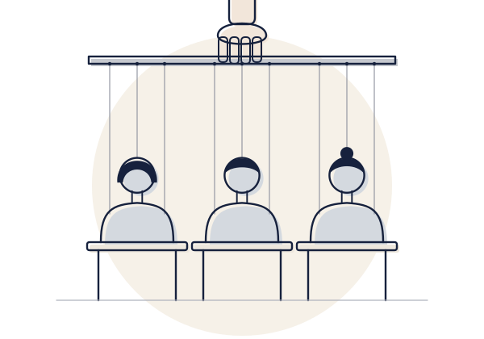
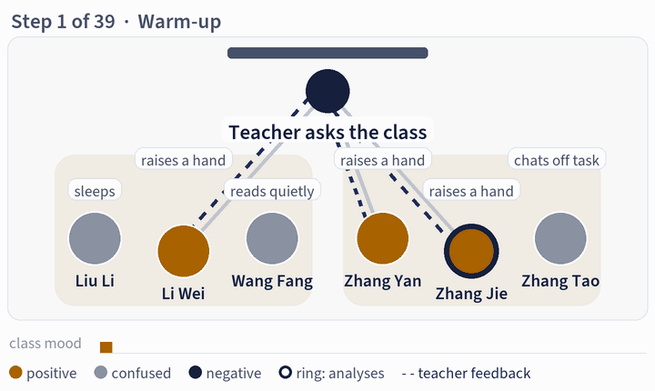
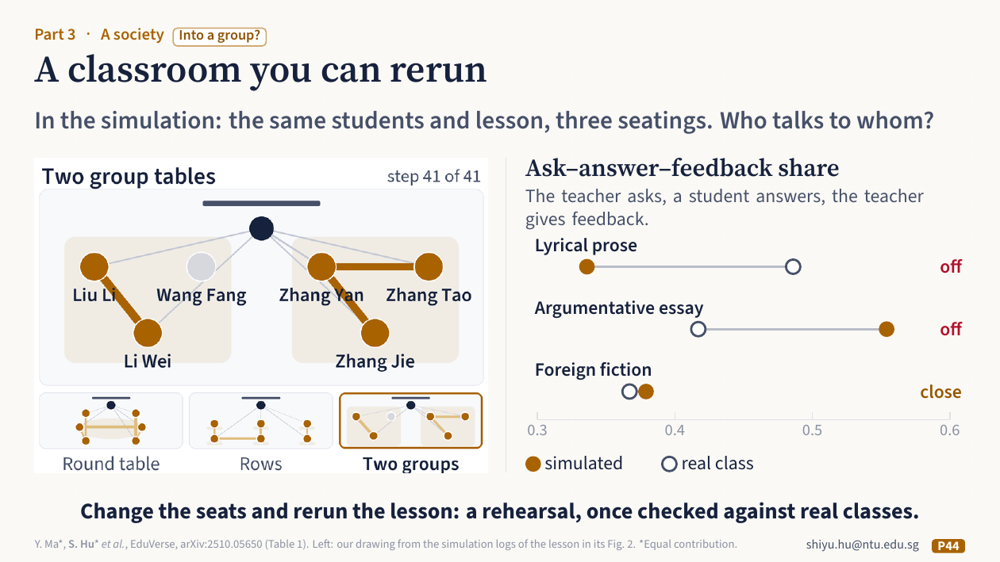
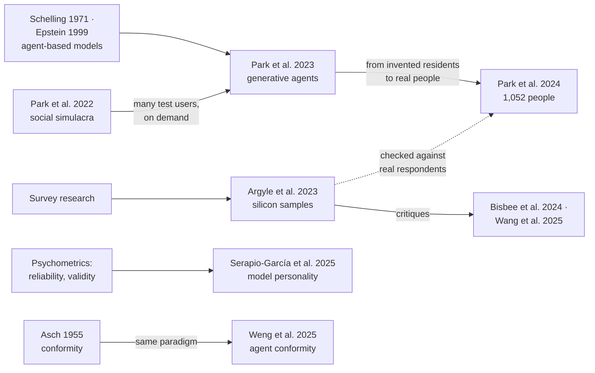

**English** · [中文](part3-people-we-make.zh.md)

# Part 3 · A society: people we make

*Is it like us enough to study us? The check: **compare it with real people**.*

## What the talk showed

**The classic work in AI.** Smallville grew out of a design need. In human–computer interaction, a new online community is tried out by a small group, but trolls and fights show up only when thousands join. So in 2022 a team let a language model play the users, and people shown one real and one generated thread picked wrong about four times in ten. In 2023 the same team built Smallville: twenty-five agents with memory, reflection and plans, in which one invitation to a party spread through the town on its own. People rated the agents as believable, which is not yet the same as behaving like real people. Then the team interviewed over a thousand people and built an agent from each. Each person answered a survey twice, two weeks apart, so an agent could be judged against the same person, measured twice.

**What psychology already knew.** Psychology maps personality with five broad traits, the Big Five (Goldberg, 1990, [doi](https://doi.org/10.1037/0022-3514.59.6.1216)). Writing "You are a shy student" into a prompt does not make a student real. And a persona is a condition the experimenter sets, so psychology treats it as a manipulation: set it, measure it, and check that it moved the trait it names, and only that trait. On a backup page, the talk points to such a check from another lab (reading 5): each trait was prompted on its own, from low to high, and mainly the trait that was prompted moved. So the check can pass, but it has to be run on the model you use.

**What the speaker's group built.** Virtual students, with people as the reference. In the first study, EduEval, a model wrote classroom replies for each Big Five persona, starting from real lesson transcripts, lesson plans and textbooks. Teachers corrected the replies, and their corrections became the examples for the rest. A small add-on module was then trained on this material for each persona; the large model underneath was not retrained. Ten raters with experience of teaching Chinese judged replies without knowing which came from AI, and after training they rated the AI replies much closer to real students' replies. Over whole sessions with trainee teachers, the persona mostly held, but one type, low conscientiousness, wavered; whether real students vary like that still has to be checked. A quiet AI reply could pass for a real student's, but it was quiet because the model had been told to be. Then a whole simulated class, EduVerse: the room sets who can talk to whom, and the same lesson can be rerun with three seatings. Two simulated students stayed very different across nine lessons: one joined in at 52% of the steps, the other at 1%, though her profile says she gradually joins in. The personas held, perhaps too well. The class was checked against one classic pattern of real classroom talk (the teacher asks, a student answers, the teacher gives feedback): close for one kind of text, different for two others.

*Slide 44 of the talk: a classroom you can rerun.*

## The question behind it

**Is it like us enough to study us?** Enough to rehearse a study, not to replace its people. Acting like a kind of person is not yet being like one. A persona is a condition you set, so it needs a manipulation check: did it move the trait it names, only that trait, and under every wording that should mean the same? A blind rating shows whether answers *look* human, not whether a mind lies behind them. A simulation is useful once it is compared with real people, at the level the claim is about: one person, a group, or a whole class.

**To check a simulation, compare it with real people.**

## What it gives back to psychology

Here the direction of the talk changes. In the first half (behavioral analysis), psychology helps us test AI; from here on (role simulation), AI helps us study people. A checked simulation is a new tool for psychology and the social sciences:

- **Many different participants, on demand.** Simulated people can rehearse a study before it reaches real ones: try the materials, the instructions and the design first.
- **A class you can rerun.** The same students and the same lesson, with the seating changed or one student swapped, run again and again: something no real school can offer. Try it in the simulation first, then confirm it with real people.
- **How to check one.** Start from real people; judge a simulated person against the same person measured twice; compare the group's spread with people's, not only its average; and watch for personas that never change and agents that, as in Smallville, rarely say no.

## Key readings

Read these five first. Each one below says what was done, what was found, what it means for this part's question, and what it does not show; its card gives the method in full and where the data are.

### 1. [Social simulacra: a community populated before it opens](../resources/examples/park2022-social-simulacra.md)

Park et al., 2022, *UIST*

**What they did.** A designer describes a new online community in plain language: its goal, its rules and a few member personas. A chain of prompts to GPT-3, each building on the answer to the last, expands this into thousands of members who post and reply, including anti-social behaviour. The authors regenerated 50 real subreddits (discussion groups on Reddit) from their goals and rules alone, and asked 200 participants to pick the real conversation from pairs of one real and one generated.

**What they found.** Participants misidentified on average 41% (SD = 10) of the pairs; guessing at random gives 50%. Conversations written by crowd workers were easier to spot (32%).

**What it means here.** This is where Smallville came from: a designer needed many different test users, on demand, the first thing this part says a checked simulation gives back. It also set an early criterion for simulated people: can people tell generated behaviour from real behaviour? Readings 2 and 3 show the same team moving from there towards comparison with real people.

**What it does not show.** Telling real from generated tests plausibility, not accuracy: a thread can look real without matching how that community would develop. The evaluation used Reddit, English, U.S. participants and the 2020 GPT-3 model, before it was trained to follow instructions.

### 2. [A town of twenty-five generative agents](../resources/examples/park2023-generative-agents.md)

Park et al., 2023, *UIST*

**What they did.** Each agent records its experiences in natural language, condenses them into higher-level reflections, and retrieves them to plan what to do next. Twenty-five agents live in a small simulated town, like a game world, inspired by *The Sims*. A hundred people rated how believable the agents were. The authors also built reduced versions, taking the parts away one after another: first reflection, then planning as well, then memory too.

**What they found.** The agents produced believable individual and emergent social behaviour. From one user-specified idea, that one agent wants to throw a Valentine's Day party, the agents spread invitations, asked each other out and arrived together at the right time. Each part of the mind made the agents more believable. The full agents scored 29.9; without reflection, 26.9; without reflection or planning, 25.6; with no memory, reflection or planning, 21.2. People playing the same roles scored 23, below the full agents.

**What it means here.** This is the study behind Smallville in the talk, and the one that made simulated people with language models a field. Its criterion is believability, which is not yet the same as behaving like real people. As this part notes, its agents also rarely say no, a sign to watch for in any simulation.

**What it does not show.** The study shows that the behaviour looks human to observers; it does not compare the agents with how real people in a real town behave. Reading 3 is the same team's answer to that gap.

### 3. [One agent for each of 1,052 people](../resources/examples/park2024-simulating-1000-people.md)

Park et al., arXiv:2411.10109

**What they did.** A stratified sample of 1,052 Americans each gave a two-hour interview to an AI interviewer, then completed the core General Social Survey (GSS), the Big Five Inventory, economic games and published experiments, twice, two weeks apart. Agents built on GPT-4o were given each person's interview, survey answers or both, and compared with agents given only demographics. Normalised accuracy divides how often an agent matches its person by how often the person matches their own earlier answers.

**What they found.** On GSS items that were not part of what the agents were given, interview agents gave their person's answer 65.67% of the time; people repeated their own answer 79.53% of the time: a normalised accuracy of 0.83 (current version, v3). Demographics alone reached 0.74.

**What it means here.** This is the step in the talk from invented residents to real people. A simulated person is judged not by whether it looks human, as in reading 2, but against the same person, measured twice. People's own two-week consistency becomes the ceiling: this part's check, made exact for one person.

**What it does not show.** Matching individuals is not reproducing how attitudes go together across a sample. In the economic games, no agent type significantly beat demographics alone, and in the experiments agents' effect sizes were larger than people's.

### 4. [Out of one, many: silicon samples](../resources/examples/argyle2023-silicon-samples.md)

Argyle et al., 2023, *Political Analysis*

**What they did.** The authors gave GPT-3 thousands of sociodemographic backstories taken from real participants in large U.S. surveys, and asked it to answer as each person would (*conditioning* the model, in AI terms). These "silicon samples" answered the same survey questions, and their answers were compared with those of real participants with the same backgrounds.

**What they found.** GPT-3's biases are not one uniform property but fine-grained and correlated with demographics, so suitable backstories make the model reproduce the response distributions of many human subgroups. The authors call this *algorithmic fidelity*, and argue that a model with enough of it can be a tool for studying people and society.

**What it means here.** Here the comparison with real people is made at the level of groups, not of one person as in reading 3. It compares response distributions, which fits this part's advice to compare a group's spread with people's, not only its average. In the talk it appears on a backup page for Part 4, on whether a model can play the participant: it can pretest a study, not replace the sample.

**What it does not show.** The comparison covers American survey respondents on the questions studied. Later work finds that silicon samples can misrepresent and flatten identity groups, and that synthetic survey data can mislead (see [How they connect](#how-they-connect)).

### 5. [Measuring and shaping a model's personality, psychometrically](../resources/examples/serapio2025-personality.md)

Serapio-García et al., 2025, *Nature Machine Intelligence*

**What they did.** Established personality inventories were given to 18 language models under many prompt set-ups (different wordings and framings of the instructions), and the scores were examined for reliability and for validity against other measures, as for human tests. In reverse, instructions set traits to target levels, and the authors checked whether text generated afterwards expressed those levels.

**What they found.** For some models, under specific prompt set-ups, the measurements were reliable and valid, more clearly so for larger models and models further trained to follow instructions. A model's output could be shaped to mimic specific human personality profiles.

**What it means here.** A persona is a condition someone sets, so it needs a manipulation check: did it move the trait it names, only that trait, and under every wording that should mean the same? This study shows what such a check looks like with psychometrics applied in full. It is the check the talk points to on a backup page: each trait prompted on its own, from low to high, and mainly the trait that was prompted moved.

**What it does not show.** The questionnaire is the first check, and it is the one the talk showed. A model told to be extraverted may score as extraverted by following the instruction rather than by having a trait, so behaviour that the persona did not name is a stronger test.

## How they connect

Four threads run through these readings.

- **From test users to a town to real people.** [Park et al.](../resources/examples/park2022-social-simulacra.md) first let a model play the users of an online community that did not exist yet (2022), then built a [town of agents](../resources/examples/park2023-generative-agents.md) (2023), then an [agent for each of 1,052 real people](../resources/examples/park2024-simulating-1000-people.md), judged against the same person measured twice (2024). The line continues an older tradition of agent-based models of society, from Schelling's segregation model (1971, [doi](https://doi.org/10.1080/0022250x.1971.9989794)) to Epstein's generative social science (1999, [doi](https://doi.org/10.1002/(sici)1099-0526(199905/06)4:5%3C41::aid-cplx9%3E3.0.co;2-f)), now with agents that talk.
- **A persona is a manipulation.** [Serapio-García et al.](../resources/examples/serapio2025-personality.md) treat a model's personality as something to be measured with psychometric standards and shaped by instructions. A persona is therefore a condition the experimenter sets. Like any manipulation, it needs a check: did it move the trait it names, only that trait, under every wording that should mean the same?
- **Simulated samples and their critics.** [Argyle et al.](../resources/examples/argyle2023-silicon-samples.md) gave a model real respondents' backgrounds to create silicon samples. Later work found that such samples can mislead (Bisbee et al., 2024, [doi](https://doi.org/10.1017/pan.2024.5)) and can misportray and flatten identity groups (Wang et al., 2025, [doi](https://doi.org/10.1038/s42256-025-00986-z)).
- **Classic paradigms as tests for agents.** [Weng et al.](../resources/examples/weng2025-conformity.md) took Asch's conformity design (1955, [doi](https://doi.org/10.1038/scientificamerican1155-31)) and ran it on language-model agents, with its controls; the talk keeps it on a backup page for questions.

**The open question.** Acting like a kind of person is not yet being like one. A simulated participant behaves as it does partly because of the persona someone gave it. To learn something about *real* people, first check that the persona did what it should, then compare the simulation with real people at the level the claim is about, such as individuals, groups or a whole classroom. Controls such as shuffled profiles and blind rating help, but they show what an output looks like, not what lies behind it.

## The wider landscape

The [field-wide list](../resources/literature.md#part-3--a-society-people-we-make) has 108 checked references for this part, grouped as follows.

| Group | What it covers | Entries |
|---|---|---|
| [Simulated participants and silicon samples](../resources/literature.md#simulated-participants-and-silicon-samples) | models answering surveys and experiments in place of people, with the critiques | 24 |
| [Personas and personality in LLMs](../resources/literature.md#personas-and-personality-in-llms) | measuring and shaping traits, stability of personas, self-report against behaviour | 15 |
| [Simulated users and students](../resources/literature.md#simulated-users-and-students) | models playing users, clients and learners | 9 |
| [Multi-agent simulations of groups and societies](../resources/literature.md#multi-agent-simulations-of-groups-and-societies-incl-abm-classics) | generative agents and classic agent-based models: segregation, cooperation, conformity | 25 |
| [Evaluation methods for simulations](../resources/literature.md#evaluation-methods-for-simulations) | how to test a simulation against real behaviour | 11 |
| [Simulation frameworks and platforms](../resources/literature.md#simulation-frameworks-and-platforms) | software for building agent simulations | 13 |
| [Data sets of real behaviour](../resources/literature.md#datasets-of-real-behaviour-used-to-validate-simulations) | real human data to compare simulations with, with access and licence | 11 |

For readings by area of psychology, see [social and cultural psychology](../resources/students.md#social-and-cultural-psychology) and [measurement and psychometrics](../resources/students.md#measurement-and-psychometrics) in the list for psychology students.

## The talk's own studies

The speaker's group, in their public versions (\* equal contribution). Read them after the key readings; they are where the talk's own examples come from.

- **EduEval: virtual students rated blind by teachers, and followed through a session.** Ma, Y.\*, Hu, S.\*, Li, X., Wang, Y., Chen, Y., Liu, S., & Cheong, K. H. When LLMs learn to be students: The SOEI framework for modeling and evaluating virtual student agents in educational interaction. [arXiv:2410.15701](https://arxiv.org/abs/2410.15701)
- **EduPersona: ten Big Five personas, rated for realism and persona consistency.** Zhu, B.\*, Hu, S.\*, Ma, Y., Zhang, Y., & Cheong, K. H. EduPersona: Benchmarking subjective ability boundaries of virtual student agents. [arXiv:2510.04648](https://arxiv.org/abs/2510.04648)
- **EduVerse: a simulated class, with seating, turns, and a lesson that can be rerun.** Ma, Y.\*, Hu, S.\*, Zhu, B., Wang, Y., Kang, Y., Liu, S., & Cheong, K. H. EduVerse: A user-defined multi-agent simulation space for education scenario. [arXiv:2510.05650](https://arxiv.org/abs/2510.05650)
- **Why simulated people come out too rational and too alike.** Hirashima, S., Hu, S., & Cheong, K. H. Beyond hyper-rationality: Persona-driven heterogeneity in networked agent-based systems. *IEEE Transactions on Network Science and Engineering*, 2026. [doi:10.1109/TNSE.2026.3742449](https://doi.org/10.1109/TNSE.2026.3742449)

## Terms

[Machine playing people](glossary.md#machine-playing-people) · [Persona](glossary.md#persona) · [Manipulation check](glossary.md#manipulation-check) · [Silicon sample](glossary.md#silicon-sample) · [Algorithmic fidelity](glossary.md#algorithmic-fidelity) · [Turing test](glossary.md#turing-test) · [Generative agent](glossary.md#generative-agent) · [Conformity](glossary.md#conformity) · [Agent-based model](glossary.md#agent-based-model)

## Work on it together

[Where the two fields meet, question 3](../resources/working-together.md#3-is-it-like-us-enough-to-study-us): what each side brings, what to read first, and published studies to learn from.

---

Next: [Part 4 · AI in your own research](part4-ai-in-your-research.md) · Previous: [Part 2 · A group: people as the answer](part2-people-as-the-answer.md) · Back to the [start page](start-here.md)
