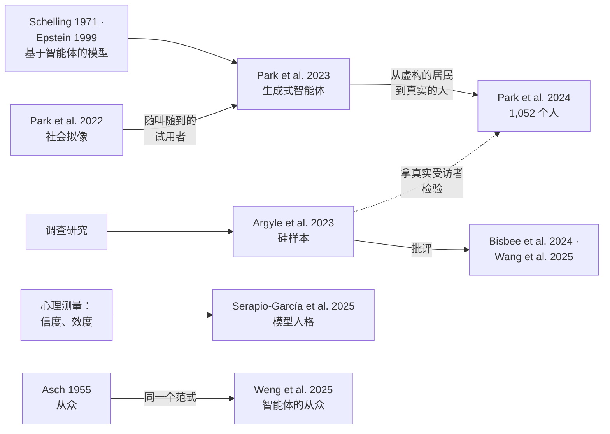

[English](part3-people-we-make.md) · **中文**

# 第 3 部分 · 一个社会：我们造出来的人

*它像我们，像到能研究我们吗？检验：**拿真实的人比**。*

## 讲座里讲了什么

**AI 领域的经典工作。** Smallville（斯坦福小镇）起源于一个设计上的需要。在人机交互领域，一个新的线上社区要先找一小群人来试用，可是捣乱和争吵只有在成千上万人加入后才会出现。于是在 2022 年，一个团队让语言模型来扮演用户；给人看一段真实的和一段生成的讨论，人大约十次里有四次认错。2023 年，同一个团队造出了 Smallville：二十五个有记忆、会反思、会做计划的智能体，一个派对邀请在镇上自己传开了。人们评价这些智能体可信，但可信还不等于行为像真实的人。之后，这个团队访谈了一千多位真人，为每个人造了一个智能体。每个人隔两周回答了两次问卷，所以智能体可以拿同一个人、测两次的结果来检验。

**心理学早就知道的。** 心理学用五个宽泛的特质来描述人格，即大五人格（Goldberg, 1990，[doi](https://doi.org/10.1037/0022-3514.59.6.1216)）。在提示词里写一句“你是一个害羞的学生”，并不能造出一个真实的学生。而且人设是实验者设定的条件，所以心理学把它当作一种操纵：设定它，测量它，再检验它是否改变了它所说的那个特质，并且只改变了这个特质。讲座在一张备用页上提到了另一个实验室做的这样一次检验（第 5 篇）：每个特质单独设定，从低到高，结果主要是被设定的那个特质在变。所以这个检验可以通过，但要在你自己用的模型上做。

**讲者团队做了什么。** 以人为参照做虚拟学生。在第一项研究 EduEval 里，一个模型从真实的课堂实录、教案和课本出发，为每种大五人格人设写出课堂上的回答。老师修改这些回答，他们的修改又成了后面各批的样例。然后，用这些材料为每种人设训练一个额外的小模块；底下的大模型本身没有重新训练。十位有语文教学经验的评分者在不知道哪些来自 AI 的情况下评价这些回答；训练之后，AI 回答得到的评分和真实学生的回答接近得多。在和师范生上完的整段课里，人设大体保持住了，但有一种类型，即低尽责性，会波动；真实学生是不是也这样变化，还需要检验。一个安静的 AI 回答可以被当成真实学生的回答，但它安静，是因为模型被要求安静。然后是一整个模拟班级 EduVerse：教室决定谁能和谁说话，同一节课可以换三种座次重来。两个模拟学生在九节课里一直差别很大：一个参与了 52% 的步骤，另一个只参与了 1%，尽管她的人物档案说她会逐渐参与进来。人设保持住了，也许保持得太好了。这个班级拿真实课堂对话的一个经典模式（老师提问、学生回答、老师反馈）来检验：在一类课文上接近，在另外两类上有差异。

*讲座第 44 页：一间能重来的教室。*

## 背后的问题

**它像我们，像到能研究我们吗？** 够用来预演一项研究，不能取代研究里的人。表现得像某一类人，并不等于就是那一类人。人设是你设定的条件，所以需要操纵检验：它有没有改变它所说的那个特质，是否只改变了这个特质，在所有意思相同的措辞下是否都如此？盲评只能说明回答*看起来*像人，不能说明背后有一个心智。模拟要拿真实的人来比，而且在主张所针对的层面上比：一个人、一个群体，还是一整个班级。

**要检验模拟，就拿真实的人比。**

## 反过来，对心理学有什么用

讲座的方向在这里反了过来。前半程（行为分析）是心理学帮我们检验 AI；从这里开始（角色模拟），是 AI 帮我们研究人。检验过的模拟，是心理学和社会科学的新工具：

- **随叫随到的、各不相同的被试。** 在研究交到真人手上之前，先让模拟的人预演一遍：先试材料、指导语和实验设计。
- **能重来的课堂。** 同样的学生、同样的一节课，换个座次或换一个学生，一遍遍重来：这是任何真实学校都做不到的。先在模拟里试，再到真人身上确认。
- **怎样检验它。** 从真实的人出发；拿同一个人、测两次的结果来检验一个模拟的人；比较群体的分布，而不只是平均数；留意那些从不改变的人设，以及像 Smallville 里那样很少说“不”的智能体。

## 重点必读

先读这五篇。下面每篇都说明做了什么、发现了什么、对这一部分的问题意味着什么，以及它没有表明什么；方法的细节和数据在哪里，见各自的卡片。

### 1. [社会拟像：开张之前就住满人的社区](../resources/examples/park2022-social-simulacra.zh.md)

Park et al., 2022, *UIST*

**做了什么。** 设计者用自然语言描述一个新的线上社区：它的目标、规则，以及几个成员人设。一连串发给 GPT-3 的提示词，每一条都接着上一条的回答往下写，把这些描述扩展成数千个成员，由他们发帖和回复，其中也包括反社会行为。作者只用 50 个真实 subreddit（Reddit 上的讨论组）的目标和规则重新生成讨论，请 200 名参与者从一真一假的成对对话中挑出真实的那段。

**发现了什么。** 参与者平均认错了 41%（SD = 10）的配对；随机猜测是 50%。众包工作者写的对话更容易被认出来（32%）。

**对这一部分意味着什么。** Smallville 正是从这里来的：设计者需要随叫随到的、各不相同的测试用户，这也是这一部分所说的、检验过的模拟能回馈的第一样东西。它还确立了评判模拟的人的一个早期标准：人能否分辨生成的行为和真实的行为？第 2、3 篇展示了同一个团队如何从这里走向与真实的人相比较。

**它没有表明什么。** 分辨真假检验的是像不像，而不是准不准：一段讨论可以看起来很真，却与这个社区实际会怎样发展并不相符。评估用的是 Reddit、英语、美国的参与者，以及 2020 年还没有经过指令训练的 GPT-3 模型。

### 2. [二十五个生成式智能体组成的小镇](../resources/examples/park2023-generative-agents.zh.md)

Park et al., 2023, *UIST*

**做了什么。** 每个智能体都用自然语言记录自己的经历，把这些记忆凝练成更高层次的反思，并检索它们来规划下一步做什么。二十五个智能体生活在一个受 *The Sims* 启发的模拟小镇里，像一个游戏世界。一百个人评价了这些智能体的可信度（像不像真人）。作者还做了几个删减版本，把各个部分依次拿掉：先去掉反思，再连规划也去掉，最后连记忆也去掉。

**发现了什么。** 智能体产生了可信的个体行为和涌现的社会行为。用户只指定了一个想法，即某个智能体想办一场情人节派对，智能体们便传播邀请、相互邀约，并在正确的时间一同到场。每个部分都让智能体更可信。完整的智能体得 29.9 分；去掉反思，26.9；去掉反思和规划，25.6；记忆、反思、规划都没有，21.2。扮演同样角色的真人得 23 分，低于完整的智能体。

**对这一部分意味着什么。** 这就是讲座里 Smallville 背后的研究，也正是它让用语言模型模拟人成为一个领域。它的评判标准是可信度，而可信还不等于行为像真实的人。正如这一部分所指出的，它的智能体还很少说“不”，这是任何模拟都要留意的迹象。

**它没有表明什么。** 研究表明，这些行为在观察者看来像人；但它没有把智能体与真实小镇里真实的人的行为相比较。第 3 篇是同一个团队对这个缺口的回应。

### 3. [为 1,052 个人各造一个智能体](../resources/examples/park2024-simulating-1000-people.zh.md)

Park et al., arXiv:2411.10109

**做了什么。** 研究者按分层抽样找了 1,052 名美国人，每人先和一个 AI 访谈员谈两小时，再做 General Social Survey（GSS）的核心部分、Big Five Inventory、经济博弈和已发表的实验，隔两周再做一遍。基于 GPT-4o 的智能体拿到的是这个人的访谈、问卷回答或两者都有，再和只拿到人口学信息的智能体比。标准化准确率的算法是：智能体答得和本人一样的比例，除以本人第二次答得和第一次一样的比例。

**发现了什么。** 在没有提供给智能体的 GSS 题目上，访谈智能体给出与本人相同答案的比例是 65.67%；人重复自己答案的比例是 79.53%：标准化准确率为 0.83（当前版本 v3）。只用人口学信息的为 0.74。

**对这一部分意味着什么。** 这是讲座里从虚构居民走到真实的人的那一步。评判一个模拟的人，不是像第 2 篇那样看它像不像人，而是拿同一个人、测两次的结果来对照。人自己两周内的一致程度成了上限：这就是这一部分的检验，在一个人身上做到了精确。

**它没有表明什么。** 与个人相符不等于重现了一个样本中各种态度之间的关联。在经济博弈中，没有哪一类智能体显著好于只用人口学信息的智能体；在实验中，智能体得出的效应量大于人的。

### 4. [由一而多：硅样本](../resources/examples/argyle2023-silicon-samples.zh.md)

Argyle et al., 2023, *Political Analysis*

**做了什么。** 作者从美国大型调查的真实参与者那里取来数千份社会人口学背景故事，交给 GPT-3，让它以每个人的身份作答（AI 领域叫作给模型设定条件）。这些“硅样本”回答同样的调查问题，答案再和背景相同的真实参与者比。

**发现了什么。** GPT-3 中的偏差不是一种单一、均匀的属性，而是细粒度的，并与人口学特征相关，因此给它合适的背景故事，模型就能重现许多人类子群体的回答分布。作者称之为*算法保真度*（*algorithmic fidelity*），并认为具备足够算法保真度的模型可以成为研究人与社会的工具。

**对这一部分意味着什么。** 这里与真实的人的比较是在群体层面上做的，而不是像第 3 篇那样在一个人的层面上。它比较的是回答分布，这正合这一部分的建议：比较群体的分布，而不只是平均数。在讲座里，它出现在第 4 部分的一张备用页上，那一页讨论模型能不能扮演被试：它可以为研究做预测试，不能取代样本。

**它没有表明什么。** 对照的只是美国调查受访者在所研究问题上的回答。后来的研究发现，硅样本可能把某些身份群体描绘错，或抹平群体内部的差异，合成的调查数据也可能误导人（见[它们之间的关系](#它们之间的关系)）。

### 5. [用心理测量学的方法测量和塑造模型的人格](../resources/examples/serapio2025-personality.zh.md)

Serapio-García et al., 2025, *Nature Machine Intelligence*

**做了什么。** 研究者用多种提示方式（指令的不同措辞和框架），让 18 个语言模型作答成熟的人格量表，再像对人类测验那样，检查这些得分的信度，以及相对于其他测量的效度。反过来，用指令把特质设定到目标水平，作者再检查随后生成的文本是否表达了这些水平。

**发现了什么。** 对某些模型而言，在特定的提示方式下，测量是可靠且有效的，对更大的模型以及经过进一步训练以遵循指令的模型更明显。模型的输出可以被塑造，以模仿特定的人类人格画像。

**对这一部分意味着什么。** 人设是有人设定的条件，所以需要操纵检验：它有没有改变它所说的那个特质，是否只改变了这个特质，在所有意思相同的措辞下是否都如此？这项研究展示了完整运用心理测量学时，这样的检验是什么样子。讲座在备用页上提到的就是这个检验：每个特质单独设定，从低到高，结果主要是被设定的那个特质在变。

**它没有表明什么。** 问卷是第一步检验，讲座里展示的也是这一步。一个模型被要求外向之后，问卷得分显示外向，可能只是在执行指令，而不是具有这种特质；所以人设没有点名的行为是更有力的检验。

## 它们之间的关系

这几篇文献贯穿着四条主线。

- **从试用者到小镇，再到真实的人。** [Park 等](../resources/examples/park2022-social-simulacra.zh.md)先让模型扮演一个还不存在的线上社区的用户（2022），再造出一个[智能体小镇](../resources/examples/park2023-generative-agents.zh.md)（2023），之后又为 [1,052 位真人各造一个智能体](../resources/examples/park2024-simulating-1000-people.zh.md)，拿同一个人、测两次的结果来检验（2024）。这条线延续了一个更早的传统，即用基于智能体的模型研究社会：从 Schelling 的隔离模型（1971，[doi](https://doi.org/10.1080/0022250x.1971.9989794)）到 Epstein 的生成式社会科学（1999，[doi](https://doi.org/10.1002/(sici)1099-0526(199905/06)4:5%3C41::aid-cplx9%3E3.0.co;2-f)），只是如今的智能体会说话了。
- **人设是一种操纵。** [Serapio-García 等](../resources/examples/serapio2025-personality.zh.md)把模型的人格当作可以用心理测量标准来测量、用指令来塑造的东西。因此人设是实验者设定的一个条件。和任何操纵一样，它需要检验：它有没有改变它所说的那个特质，是否只改变了这个特质，在所有意思相同的措辞下是否都如此？
- **模拟样本和它的批评者。** [Argyle 等](../resources/examples/argyle2023-silicon-samples.zh.md)把真实受访者的背景交给模型，生成硅样本。后来的研究发现，这类样本可能误导人（Bisbee 等，2024，[doi](https://doi.org/10.1017/pan.2024.5)），还可能歪曲并抹平身份群体（Wang 等，2025，[doi](https://doi.org/10.1038/s42256-025-00986-z)）。
- **经典范式成为检验智能体的测试。** [Weng 等](../resources/examples/weng2025-conformity.zh.md)把 Asch 的从众实验设计（1955，[doi](https://doi.org/10.1038/scientificamerican1155-31)）连同它的控制条件一起，搬到了语言模型智能体身上；讲座把它放在问答用的备用页上。

**悬而未决的问题。** 表现得像某一类人，并不等于就是那一类人。一个模拟被试之所以这样表现，部分是因为有人给了它这样的人设。要了解*真实的*人，先要检验人设是否起到了应有的作用，再在主张所针对的层面上，比如个人、群体或一整个课堂，把模拟与真实的人相比较。打乱资料、盲评这类控制有帮助，但它们说明的是输出看起来怎样，而不是背后有什么。

## 更大的版图

[全领域文献清单](../resources/literature.md#part-3--a-society-people-we-make)（英文）为这一部分收录了 108 篇核实过的参考文献，分组如下。

| 分组 | 涵盖内容 | 条目数 |
|---|---|---|
| [模拟被试与硅样本](../resources/literature.md#simulated-participants-and-silicon-samples) | 模型代替人回答调查和实验，以及相关批评 | 24 |
| [大语言模型的人设与人格](../resources/literature.md#personas-and-personality-in-llms) | 测量和塑造特质、人设的稳定性、自我报告与行为的对照 | 15 |
| [模拟的用户与学生](../resources/literature.md#simulated-users-and-students) | 模型扮演用户、来访者和学习者 | 9 |
| [群体与社会的多智能体模拟](../resources/literature.md#multi-agent-simulations-of-groups-and-societies-incl-abm-classics) | 生成式智能体和经典的基于智能体的模型：隔离、合作、从众 | 25 |
| [模拟的评测方法](../resources/literature.md#evaluation-methods-for-simulations) | 怎样对照真实行为来检验一个模拟 | 11 |
| [模拟框架与平台](../resources/literature.md#simulation-frameworks-and-platforms) | 搭建智能体模拟的软件 | 13 |
| [真实行为数据集](../resources/literature.md#datasets-of-real-behaviour-used-to-validate-simulations) | 可以拿来与模拟对照的真实人类数据，以及获取方式和许可 | 11 |

按心理学分支的阅读，见给心理学学生的清单（英文）中的[社会与文化心理学](../resources/students.md#social-and-cultural-psychology)和[测量与心理测量](../resources/students.md#measurement-and-psychometrics)。

## 讲座里讲者团队自己的研究

讲者团队的研究，只列公开版本（\* 为共同第一作者）。建议读完重点必读再看；讲座里我们自己的例子都出自这里。

- **EduEval：老师盲评虚拟学生，并跟着它们上完一节课。** Ma, Y.\*, Hu, S.\*, Li, X., Wang, Y., Chen, Y., Liu, S., & Cheong, K. H. When LLMs learn to be students: The SOEI framework for modeling and evaluating virtual student agents in educational interaction. [arXiv:2410.15701](https://arxiv.org/abs/2410.15701)
- **EduPersona：十种大五人格人设，评价是否真实、人设是否一致。** Zhu, B.\*, Hu, S.\*, Ma, Y., Zhang, Y., & Cheong, K. H. EduPersona: Benchmarking subjective ability boundaries of virtual student agents. [arXiv:2510.04648](https://arxiv.org/abs/2510.04648)
- **EduVerse：模拟班级，有座次、发言轮次，以及能重来的一节课。** Ma, Y.\*, Hu, S.\*, Zhu, B., Wang, Y., Kang, Y., Liu, S., & Cheong, K. H. EduVerse: A user-defined multi-agent simulation space for education scenario. [arXiv:2510.05650](https://arxiv.org/abs/2510.05650)
- **为什么模拟的人太理性、太相似。** Hirashima, S., Hu, S., & Cheong, K. H. Beyond hyper-rationality: Persona-driven heterogeneity in networked agent-based systems. *IEEE Transactions on Network Science and Engineering*, 2026. [doi:10.1109/TNSE.2026.3742449](https://doi.org/10.1109/TNSE.2026.3742449)

## 术语

[机器演人](glossary.zh.md#机器演人machine-playing-people) · [人设](glossary.zh.md#人设persona) · [操纵检验](glossary.zh.md#操纵检验manipulation-check) · [硅样本](glossary.zh.md#硅样本silicon-sample) · [算法保真度](glossary.zh.md#算法保真度algorithmic-fidelity) · [图灵测试](glossary.zh.md#图灵测试turing-test) · [生成式智能体](glossary.zh.md#生成式智能体generative-agent) · [从众](glossary.zh.md#从众conformity) · [基于智能体的模型](glossary.zh.md#基于智能体的模型agent-based-model)

## 一起做

[两个领域在哪里相遇，第 3 个问题](../resources/working-together.zh.md#3-它像我们像到能研究我们吗)：两边各带来什么、先读什么，以及可以借鉴的已发表研究。

---

下一部分：[第 4 部分 · 在你自己的研究里用 AI](part4-ai-in-your-research.zh.md) · 上一部分：[第 2 部分 · 一群人：人作为答案](part2-people-as-the-answer.zh.md) · 回到[开始页](start-here.zh.md)
