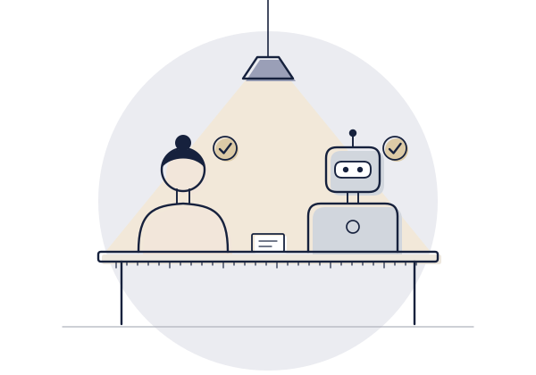
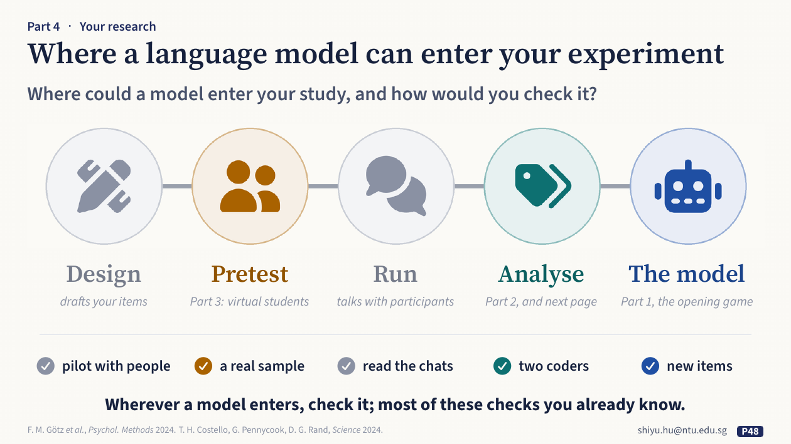
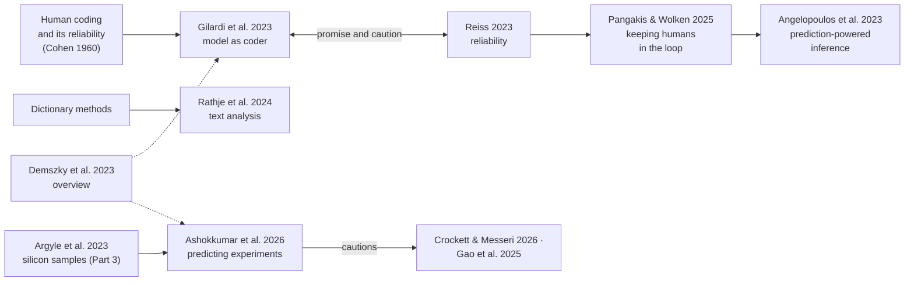

**English** · [中文](part4-ai-in-your-research.zh.md)

# Part 4 · AI in your own research

*How can you use it? Check it first, then use it.*

## What the talk showed

**Five places, five checks.** A language model can enter a study at five places, and the talk linked each one to an earlier part. It can draft your items: one team let a model draft items for a new scale and for short Big Five scales, then tested them with more than 1,200 people (Götz et al., 2024, [doi](https://doi.org/10.1037/met0000540)). It can pretest a study by playing the participants, like Part 3's virtual students. It can run the study as the one participants talk to: in one study, more than 2,000 people who believed a conspiracy theory talked with GPT-4 Turbo, and their belief fell by about 20%, still lower two months later (Costello et al., 2024, [doi](https://doi.org/10.1126/science.adq1814); an erratum appeared on 22 October 2026, [doi](https://doi.org/10.1126/science.aem1178)). It can code what participants said, as in Part 2. And it can be the participant itself, as in the opening game and Part 1. For each place the talk named a check that psychology already uses: a pilot with people for drafted items, a real sample after a simulated pretest, reading every conversation when a model talks with participants, two human coders when it codes, and new items when it is the participant. A simulated participant can pretest a study; it does not replace the sample.

*Slide 48 of the talk: where a language model can enter your experiment.*

**A model as a new coder.** For analysis, the talk proposed treating a model as psychology treats any new coder (Gilardi et al., 2023, reading 2). Its example was 100 video descriptions, with each sentence labelled *seen* (what anyone can see) or *inferred* (a feeling or intention). The talk described four steps: fix the prompt and settings, and run it three times; have two people label 30 descriptions and compare the model with each, using Cohen's kappa; reword the prompt once and see whether the labels hold; and report the model, version, date, prompt, runs and kappas. The reason behind the steps: a model that agrees with itself has not yet been shown to agree with people.

**Three old traps, in a new form.** Whatever role the model plays, three traps come back, and psychology knows each of them already. The model changes, like a measuring device that drifts: on the same prime-number questions, GPT-4 was right 84% of the time in March 2023 and 51% in June (Chen, Zaharia & Zou, 2024, [doi](https://doi.org/10.1162/99608f92.5317da47)). The wording moves the answer, as survey researchers have long known (Reiss, 2023). And a classic task may test less than it seems, like a participant who already knows the task: GPT-3 solved a well-known card task but failed once the cards were reordered (Binz & Schulz, 2023, [doi](https://doi.org/10.1073/pnas.2218523120)). The talk's answer to each: record the version and date, vary the wording, and build new items.

## The question behind it

**How can you use it?** Check it first, then use it. A simulated participant or an AI coder is a measurement tool you have not validated yet. At each place it enters, ask the questions of the first three parts: Right answer, right reason? (compare the mistakes, not only the scores); Whose standard does it follow? (compare with a group, not one person); Is it like us enough to study us? (compare it with real people). Record the model, version, date, full prompt, settings and number of runs, so that someone else can check.

**Wherever a model enters, check it; most of these checks you already know.**

## What it gives back to psychology

Here the talk hands its checks back to psychology in psychology's own terms. A model in your study is one more tool to validate, and the validation is work psychology already knows: a pilot with people, a real sample, two coders and an agreement statistic, new items for a familiar task. Used this way, a model can make some steps cheaper, such as drafting items, rehearsing a design or a first pass of coding, while the conclusions still rest on people.

Part 4 ends with the speaker's own view. AI is improving fast, so a result about one model ages in months, while good questions and good measures last. And as research output grows, making work becomes easy and judging it becomes hard. When making things gets cheap, judging becomes the real work, and judging has always been the craft of psychology and the humanities.

## Key readings

Read these five first. Each one below says what was done, what was found, what it means for this part's question, and what it does not show; its card gives the method in full and where the data are.

### 1. [What language models can and cannot do for psychology](../resources/examples/demszky2023-llms-in-psychology.md)

Demszky et al., 2023, *Nature Reviews Psychology*

**What they did.** Psychologists and computer scientists wrote this Perspective article together. It explains how language models produce human-like language without thinking or feeling like a person, then reviews their uses in psychological measurement, experimentation and practice.

**What they found.** The authors argue that models could advance all three, but are not yet ready for many of the most transformative applications. They examine four major concerns and recommend three investments: field-initiated "keystone" data sets, more standardised benchmarks, and shared computing and analysis infrastructure.

**What it means here.** Not shown in the talk. It is the broadest single map of the topic written for psychologists, and a good first reading: it covers all three uses in this part (a model as a coder, measuring constructs in text, a simulated participant) and the concerns that come with them. The other four readings each look at one use in detail.

**What it does not show.** It dates from 2023; the models have changed since, though the concerns have not gone away. It reviews and argues; it reports no new data.

### 2. [A model as a coder: promising, and in need of validation](../resources/examples/gilardi2023-ai-annotation.md)

Gilardi et al., 2023, *PNAS*, read with Reiss, 2023

**What they did.** Gilardi and colleagues compared ChatGPT, given no examples ("zero-shot"), with crowd workers and trained annotators (what psychology calls coders) on four coding tasks in tweets and news articles (n = 6,183). Reiss repeated identical inputs on one real task, sorting website texts into news and not news, and varied the settings and the prompt wording.

**What they found.** ChatGPT's zero-shot accuracy beat that of crowd workers by about 25 percentage points on average, its intercoder agreement was higher than that of crowd workers and trained annotators on all tasks, and it cost about thirty times less. Reiss found that a small change in wording, or simply a repeat, can change the output; pooling repetitions helps.

**What it means here.** This is the talk's point: treat a model as a new coder, and check it as psychology checks any coder, by agreement with others on the same material. Reiss shows one of the old traps in its new form: the wording moves the answer. Reading 4 takes up what follows once the labels are used.

**What it does not show.** Both studies cover particular tasks, languages and model versions at one moment; a result for one coding scheme does not transfer automatically to another.

### 3. [Psychological text analysis in twelve languages](../resources/examples/rathje2024-psychological-text.md)

Rathje et al., 2024, *PNAS*

**What they did.** Three versions of GPT were given simple prompts, such as "is this text negative?", to detect sentiment, emotions, offensiveness and moral foundations in 47,925 tweets and news headlines in 12 languages that people had already annotated. Their answers were compared with the human annotations, dictionary methods and fine-tuned models (models trained further for one task).

**What they found.** GPT's agreement with the human annotators (r = 0.59 to 0.77) was much higher than that of English-language dictionary analysis (r = 0.20 to 0.30), and close to, sometimes better than, several top fine-tuned models. Newer versions did better, especially for lesser-spoken languages.

**What it means here.** Not shown in the talk. This is the use psychologists are most likely to make of a model every day, measuring constructs in text, checked in a familiar way: against human judgement and the field's existing methods. Because results changed from version to version, it also shows why the version must be recorded.

**What it does not show.** "Accurate" here means agreement with the existing annotations, so the model is only as valid as they are. Correlations of 0.6 to 0.8 leave room for systematic differences on particular kinds of text.

### 4. [Valid conclusions from AI labels and a few human labels](../resources/examples/angelopoulos2023-prediction-powered-inference.md)

Angelopoulos et al., 2023, *Science*

**What they did.** This is a statistical framework, not an experiment. A small set of items labelled by people measures how far a model's predictions are off, and that correction is applied to the estimate from the large set the model labelled. It gives confidence intervals for means, quantiles, and linear and logistic regression coefficients.

**What they found.** The intervals are provably valid, with no assumptions about the system that supplies the predictions; the more accurate the predictions, the narrower they are. Demonstrations come from six fields, from proteomics to ecology.

**What it means here.** Not shown in the talk. It answers the question that follows reading 2: if a model codes most of the data, what can still be concluded, and how many human labels are needed? It builds this part's lesson for coders, validate against people every time, into the estimate itself.

**What it does not show.** The human-labelled items must be a random sample from the same population as the model-labelled ones. The method corrects the model's errors on average; it does not make a biased model's labels valid item by item.

### 5. [Predicting the results of experiments before running them](../resources/examples/ashokkumar2026-predicting-experiments.md)

Ashokkumar et al., 2026, *Nature*

**What they did.** The authors prompted a model to simulate how representative American samples would respond to 70 preregistered US survey experiments (469 effects, 119,330 participants), and compared the simulated responses across conditions. Fifteen megastudies (606 effects) served as a further test.

**What they found.** GPT-4's predictions correlated strongly with the actual effects, about as accurately as pooled forecasts by people, including for studies not published or posted before its training data were collected (its training cutoff). The predictions systematically overestimated effect sizes. For the megastudies, correlations were lower but comparable to those of pooled expert forecasters.

**What it means here.** Not shown in the talk, it bears out the talk's point that a simulated participant can pretest a study but does not replace the sample. It supports one careful use: predicting the direction of effects to choose, pilot or prioritise studies. It follows Part 3's silicon samples; the check is Part 3's: compare it with real people.

**What it does not show.** The experiments are American survey experiments. A good correlation across many effects does not make any single prediction reliable, and overestimated effect sizes would mislead a power calculation used in place of a pilot with people.

## How they connect

Three threads run through these readings.

- **A model as a coder.** Psychology already knows how to check a coder: agreement with other coders on the same material. [Gilardi et al.](../resources/examples/gilardi2023-ai-annotation.md) found a model more accurate and more consistent than crowd workers. Reiss found its output could change with the wording of the prompt or simply on a second run. Pangakis and Wolken (2025, *Keeping humans in the loop: Human-centered automated annotation with generative AI*, ICWSM, [doi](https://doi.org/10.1609/icwsm.v19i1.35883)) draw the conclusion: validate against people every time. [Prediction-powered inference](../resources/examples/angelopoulos2023-prediction-powered-inference.md) and design-based supervised learning (Egami et al., 2023, [doi](https://doi.org/10.52202/075280-3000)) then show how to draw valid conclusions from model labels plus a set of human ones.
- **Measuring constructs in text.** [Rathje et al.](../resources/examples/rathje2024-psychological-text.md) compare a model with the dictionary methods psychologists have long used, and find it much closer to human judgement, in many languages.
- **A simulated participant as a pretest.** [Silicon samples](../resources/examples/argyle2023-silicon-samples.md) (a key reading in Part 3; in the talk, on a backup page for this part) raised the idea; [Ashokkumar et al.](../resources/examples/ashokkumar2026-predicting-experiments.md) test it on 70 real experiments and find good predictions of direction and inflated effect sizes. Crockett and Messeri (2026, *AI surrogates and illusions of generalizability in cognitive science*, [doi](https://doi.org/10.1016/j.tics.2025.09.012)) and Gao et al. (2025, *Take caution in using LLMs as human surrogates*, [doi](https://doi.org/10.1073/pnas.2501660122)) set out why a simulation should not take the place of the sample.

[Demszky et al.](../resources/examples/demszky2023-llms-in-psychology.md) cover all three uses, and the concerns that come with them.

**The open question.** Using a model in your research turns it into one of your measurement tools. The checks from the first three parts apply to it as to any tool: compare the mistakes, not only the scores (where does it go wrong, and does a small change in the prompt change the answer?); compare with a group, not one person (is it validated against more than one person?); and compare it with real people (a pretest, not the sample). Record the model, version, date, full prompt, settings and number of runs, so that someone else can check.

## The wider landscape

The field-wide list has two sections for this part, with 39 checked references between them.

| Group | What it covers | Entries |
|---|---|---|
| [LLMs as annotators and coders](../resources/literature.md#llms-as-annotators--coders-of-psychological-and-social-science-constructs) | models labelling text for psychology and the social sciences; validation; statistics for using model labels | 15 |
| [Simulated participants and silicon samples](../resources/literature.md#simulated-participants-and-silicon-samples) | models answering surveys and experiments in place of people, with the critiques | 24 |

## The talk's own studies

Part 4 draws on the studies listed in [Part 1](part1-people-next-to-machine.md#the-talks-own-studies), [Part 2](part2-people-as-the-answer.md#the-talks-own-studies) and [Part 3](part3-people-we-make.md#the-talks-own-studies).

## Terms

[AI coder](glossary.md#ai-coder) · [Prompt sensitivity](glossary.md#prompt-sensitivity) · [Prediction-powered inference](glossary.md#prediction-powered-inference) · [Simulated participant](glossary.md#simulated-participant) · [Inter-rater reliability](glossary.md#inter-rater-reliability) · [LLM as a judge](glossary.md#llm-as-a-judge) · [Silicon sample](glossary.md#silicon-sample)

## Work on it together

[Way 4, *bring a model into your own study*](../resources/working-together.md#4-bring-a-model-into-your-own-study). Whichever way you work, record the model, version, date, full prompt, settings and number of runs.

---

Previous: [Part 3 · A society: people we make](part3-people-we-make.md) · Back to the [start page](start-here.md)
