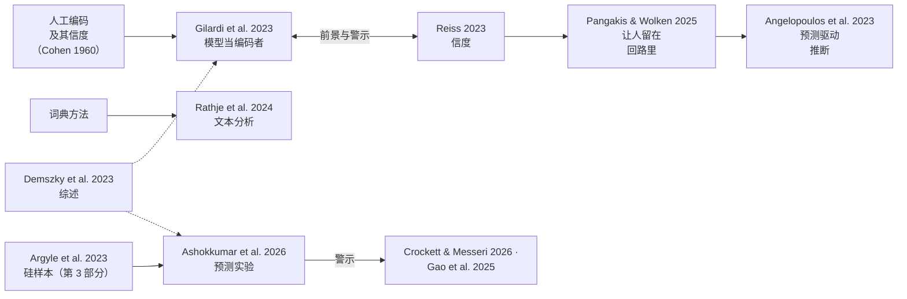

[English](part4-ai-in-your-research.md) · **中文**

# 第 4 部分 · 在你自己的研究里用 AI

*你可以怎样用它？先检验，再使用。*

## 讲座里讲了什么

**五个环节，五种检验。** 语言模型可以在五个环节进入一项研究，讲座把每个环节都和前面的某一部分连了起来。它可以起草题目：一个团队让模型为一个新量表和几个简版大五人格量表起草题目，再拿 1,200 多个人来检验这些题目（Götz et al., 2024，[doi](https://doi.org/10.1037/met0000540)）。它可以扮演被试，为研究做预测试，就像第 3 部分的虚拟学生。它可以执行研究，成为被试对话的那一方：在一项研究里，2,000 多位相信某个阴谋论的人和 GPT-4 Turbo 对话，他们的相信程度下降了约 20%，两个月后仍然较低（Costello et al., 2024，[doi](https://doi.org/10.1126/science.adq1814)；2026 年 10 月 22 日发表了一则勘误，[doi](https://doi.org/10.1126/science.aem1178)）。它可以给被试说的话编码，就像第 2 部分。它也可以自己就是被试，就像开场的游戏和第 1 部分。对每个环节，讲座都指出了一种心理学已经在用的检验：起草的题目要拿真人做预实验，模拟的预测试之后要有真实样本，模型和被试对话时要读每一段对话，模型编码时要有两位人工编码者，模型当被试时要用新的题目。模拟被试可以用来预测试一项研究，但不能取代样本。

*讲座第 48 页：语言模型可以从哪里进入你的实验。*

**把模型当作一位新的编码者。** 对于分析，讲座提出像心理学对待任何新编码者那样对待模型（Gilardi et al., 2023，第 2 篇）。它的例子是 100 条视频描述，每句话标为*看到的*（谁都能看到的）或*推断的*（一种感受或意图）。讲座讲了四步：固定提示词和设置，运行三次；请两个人给 30 条描述打标签，把模型分别和两人比，用 Cohen's kappa；改一次提示词的措辞，看标签是否不变；报告模型、版本、日期、提示词、运行次数和各个 kappa。这几步背后的道理是：模型和自己一致，还不能说明它和人一致。

**三个老陷阱换了新的样子。** 不管模型扮演哪个角色，都会遇到三个陷阱，而每一个心理学都早已熟悉。模型会变，就像一台会漂移的测量设备：同样的质数题，GPT-4 在 2023 年 3 月答对 84%，到 6 月只答对 51%（Chen, Zaharia & Zou, 2024，[doi](https://doi.org/10.1162/99608f92.5317da47)）。措辞会改变答案，做问卷调查的人早就知道这一点（Reiss, 2023）。经典任务测到的可能比看上去少，就像一个早就知道任务的被试：GPT-3 解出了一个有名的卡片任务，卡片顺序一换就失败了（Binz & Schulz, 2023，[doi](https://doi.org/10.1073/pnas.2218523120)）。讲座对这三个陷阱的回答是：记录版本和日期，变换措辞，设计新的题目。

## 背后的问题

**你可以怎样用它？** 先检验，再使用。模拟被试或 AI 编码者，是一个你还没有验证过的测量工具。它从哪个环节进入，就在那里问前三部分的问题：答对了，理由也对吗？（比错误，不只比分数）；它遵循谁的标准？（拿一群人比，不拿一个人比）；它像我们，像到能研究我们吗？（拿真实的人比）。记下模型、版本、日期、完整的提示词、设置和运行次数，让别人能够核查。

**模型从哪个环节进入，就在哪里检验它；这些检验大多你早已熟悉。**

## 反过来，对心理学有什么用

在这里，讲座用心理学自己的话，把它的检验交还给心理学。研究里的模型只是又一个需要验证的工具，而验证本来就是心理学熟悉的工作：拿真人做预实验，用真实样本，请两位编码者并算一致性，为熟悉的任务设计新题目。这样用，模型可以让某些步骤更省力，比如起草题目、预演一个设计，或者做第一轮编码，而结论仍然要靠人来支撑。

第 4 部分最后是讲者自己的看法。AI 进步得很快，所以关于某一个模型的结果几个月就会过时，而好的问题和好的测量能留得更久。研究产出越来越多，做出东西变得容易，评判它们却越来越难。造东西变便宜之后，判断成了真正的工作；而判断一直是心理学和人文学科的手艺。

## 重点必读

先读这五篇。下面每篇都说明做了什么、发现了什么、对这一部分的问题意味着什么，以及它没有表明什么；方法的细节和数据在哪里，见各自的卡片。

### 1. [语言模型能为心理学做什么，不能做什么](../resources/examples/demszky2023-llms-in-psychology.zh.md)

Demszky et al., 2023, *Nature Reviews Psychology*

**做了什么。** 这是一篇由心理学家和计算机科学家合写的 Perspective（观点）文章。它解释了语言模型如何产生类似人类的语言，却不像人那样思考或感受，随后综述了语言模型在心理测量、实验和实践中的用途。

**发现了什么。** 作者认为，模型可能推动这三方面，但对许多最具变革性的应用还没有准备好。他们考察了四个重大担忧，并建议做三项投入：由领域发起的 “keystone”（基石）数据集，更标准化的基准，以及共享的计算与分析基础设施。

**对这一部分意味着什么。** 讲座里没有展示。它是专为心理学家写的、关于这一主题最全面的单篇地图，很适合第一个读：它涵盖了这一部分的三种用法（模型当编码者、测量文本中的构念、模拟被试），以及随之而来的担忧。其余四篇各自细看一种用法。

**它没有表明什么。** 它写于 2023 年；此后模型已经变了，不过这些担忧并没有消失。它是综述和论证，没有报告新的数据。

### 2. [让模型当编码者：有前景，但需要验证](../resources/examples/gilardi2023-ai-annotation.zh.md)

Gilardi et al., 2023, *PNAS*，与 Reiss, 2023 一起读

**做了什么。** Gilardi 及其同事在推文和新闻文章（n = 6,183）的四类编码任务上，把不给示例（“zero-shot”，零样本）的 ChatGPT 与众包工作者和受过训练的标注者（心理学里叫编码者）相比较。Reiss 在一个真实任务上（把网站文本分为新闻和非新闻）重复输入完全相同的内容，并改变设置和提示词的措辞。

**发现了什么。** ChatGPT 的零样本准确率平均比众包工作者高约 25 个百分点；在所有任务上，它的编码者间一致性都高于众包工作者和受过训练的标注者；成本约为众包的三十分之一。Reiss 发现，措辞有微小变化，或者只是重复一次，输出都可能改变；把多次重复的结果合并起来会有帮助。

**对这一部分意味着什么。** 这正是讲座说的：把模型当作一位新的编码者，并像心理学检验任何编码者那样检验它，即看它和其他编码者在同样材料上的一致性。Reiss 让人看到一个老陷阱换了新样子之后如何起作用：措辞会改变答案。第 4 篇接着讨论用上这些标签之后的问题。

**它没有表明什么。** 两项研究都只涵盖某一时刻的特定任务、语言和模型版本；一种编码方案上的结果不会自动迁移到另一种方案。

### 3. [用十二种语言做心理学文本分析](../resources/examples/rathje2024-psychological-text.zh.md)

Rathje et al., 2024, *PNAS*

**做了什么。** 研究者给三个版本的 GPT 简单的提示，例如 “is this text negative?”（这段文本是负面的吗？），让它们在 47,925 条已由人标注过的推文和新闻标题中检测情感倾向、情绪、冒犯性和道德基础，涵盖 12 种语言。它们的回答与人类标注、词典方法和微调过的模型（针对某一任务进一步训练过的模型）相比较。

**发现了什么。** GPT 与人类标注者的一致性（r = 0.59 到 0.77）远高于英语词典分析（r = 0.20 到 0.30），并接近、有时还超过了几个顶尖的微调过的模型。新版本表现更好，在使用人数较少的语言上尤其明显。

**对这一部分意味着什么。** 讲座里没有展示。测量文本中的构念，是心理学家最可能对模型做的日常用途；这里用熟悉的方式检验它：对照人的判断和这个领域已有的方法。由于结果随版本而变，它也说明了为什么必须记下版本。

**它没有表明什么。** 这里的“准确”指与现有标注一致，因此模型的效度最多与这些标注相当。0.6 到 0.8 的相关仍然给特定类型文本上的系统差异留下了空间。

### 4. [用 AI 标签加少量人工标签得出有效结论](../resources/examples/angelopoulos2023-prediction-powered-inference.zh.md)

Angelopoulos et al., 2023, *Science*

**做了什么。** 这是一个统计框架，不是一项实验。用人标注的少量条目衡量模型的预测偏离多远，再把这一校正应用到由模型标注的大量条目所得的估计上。它为均值、分位数以及线性回归和逻辑回归系数给出置信区间。

**发现了什么。** 这些区间可以证明是有效的，而且对提供预测的系统不作任何假设；预测越准确，区间越窄。演示数据来自六个领域，从蛋白质组学到生态学。

**对这一部分意味着什么。** 讲座里没有展示。它回答了第 2 篇之后的问题：如果模型编码了大部分数据，还能得出什么结论，又需要多少人工标签？它把这一部分对编码者的结论，即每次都要对照人来验证，纳入了估计本身。

**它没有表明什么。** 人工标注的条目必须是从与模型标注条目相同的总体中抽取的随机样本。该方法在平均意义上校正模型的误差；它不会让有偏模型的标签逐条变得有效。

### 5. [在做实验之前预测它的结果](../resources/examples/ashokkumar2026-predicting-experiments.zh.md)

Ashokkumar et al., 2026, *Nature*

**做了什么。** 作者提示模型模拟有代表性的美国样本会如何回应 70 项预注册的美国调查实验（469 个效应，119,330 名参与者），并比较不同条件下的模拟回答。15 项大型研究（megastudies，606 个效应）作为进一步的检验。

**发现了什么。** GPT-4 的预测与实际效应高度相关，准确度与人们汇总后的预测相近，对于在它的训练数据收集完毕（即训练截止日期）之前没有发表或公开的研究也是如此。这些预测系统性地高估了效应量。在大型研究上，相关性较低，但与汇总后的专家预测者相当。

**对这一部分意味着什么。** 讲座里没有展示，但它印证了讲座的观点：模拟被试可以用来预测试一项研究，但不能取代样本。它支持一种谨慎的用法：预测效应的方向，用来挑选研究、做预实验或排定研究的优先顺序。它承接第 3 部分的硅样本；这里的检验与第 3 部分相同：拿真实的人比。

**它没有表明什么。** 这些实验都是美国的调查实验。在许多效应上相关良好，并不能让任何单个预测变得可靠；如果用高估的效应量代替真人预实验来做功效分析，会产生误导。

## 它们之间的关系

这几篇文献贯穿着三条主线。

- **模型当编码者。** 心理学早就知道怎样检验一位编码者：看他和其他编码者在同样材料上的一致性。[Gilardi 等](../resources/examples/gilardi2023-ai-annotation.zh.md)发现模型比众包工作者更准确、更一致。Reiss 发现，提示词的措辞一变，甚至只是再运行一次，它的输出都可能改变。Pangakis 和 Wolken（2025，*Keeping humans in the loop: Human-centered automated annotation with generative AI*，ICWSM，[doi](https://doi.org/10.1609/icwsm.v19i1.35883)）得出结论：每次都要对照人来验证。[预测驱动推断](../resources/examples/angelopoulos2023-prediction-powered-inference.zh.md)和基于设计的监督学习（Egami 等，2023，[doi](https://doi.org/10.52202/075280-3000)）则说明了怎样从模型标签加一组人工标签中得出有效的结论。
- **测量文本中的构念。** [Rathje 等](../resources/examples/rathje2024-psychological-text.zh.md)把模型与心理学家长期使用的词典方法相比较，发现模型在多种语言中都更接近人的判断。
- **模拟被试用于预测试。** [硅样本](../resources/examples/argyle2023-silicon-samples.zh.md)（第 3 部分的重点必读；讲座里放在这一部分的备用页上）提出了这个想法；[Ashokkumar 等](../resources/examples/ashokkumar2026-predicting-experiments.zh.md)在 70 个真实实验上检验它，发现方向预测得好，效应大小却被夸大。Crockett 和 Messeri（2026，*AI surrogates and illusions of generalizability in cognitive science*，[doi](https://doi.org/10.1016/j.tics.2025.09.012)）以及 Gao 等（2025，*Take caution in using LLMs as human surrogates*，[doi](https://doi.org/10.1073/pnas.2501660122)）阐明了为什么模拟不应该取代样本。

[Demszky 等](../resources/examples/demszky2023-llms-in-psychology.zh.md)涵盖了这三种用法，以及随之而来的顾虑。

**悬而未决的问题。** 在研究里用一个模型，它就成了你的测量工具之一。前三部分的检验对它和对任何工具一样适用：比错误，不只比分数（它错在哪里？提示词的一点小改动会不会改变答案？）；拿一群人比，不拿一个人比（它是否对照不止一个人做过验证？）；以及拿真实的人比（用作预测试，而不是当作样本）。记下模型、版本、日期、完整的提示词、设置和运行次数，让别人能够核查。

## 更大的版图

全领域文献清单（英文）为这一部分提供了两个分组，共 39 篇核实过的参考文献。

| 分组 | 涵盖内容 | 条目数 |
|---|---|---|
| [大语言模型当标注者和编码者](../resources/literature.md#llms-as-annotators--coders-of-psychological-and-social-science-constructs) | 模型为心理学和社会科学的文本打标签；验证；使用模型标签的统计方法 | 15 |
| [模拟被试与硅样本](../resources/literature.md#simulated-participants-and-silicon-samples) | 模型代替人回答调查和实验，以及相关批评 | 24 |

## 讲座里讲者团队自己的研究

第 4 部分用到的，是[第 1 部分](part1-people-next-to-machine.zh.md#讲座里讲者团队自己的研究)、[第 2 部分](part2-people-as-the-answer.zh.md#讲座里讲者团队自己的研究)和[第 3 部分](part3-people-we-make.zh.md#讲座里讲者团队自己的研究)里列出的研究。

## 术语

[AI 编码者](glossary.zh.md#ai-编码者ai-coder) · [提示词敏感性](glossary.zh.md#提示词敏感性prompt-sensitivity) · [预测驱动推断](glossary.zh.md#预测驱动推断prediction-powered-inference) · [模拟被试](glossary.zh.md#模拟被试simulated-participant) · [评分者信度](glossary.zh.md#评分者信度inter-rater-reliability) · [大语言模型当评判者](glossary.zh.md#大语言模型当评判者llm-as-a-judge) · [硅样本](glossary.zh.md#硅样本silicon-sample)

## 一起做

[合作方式 4，*把模型带进你自己的研究*](../resources/working-together.zh.md#4-把模型带进你自己的研究)。无论用哪种方式，都要记下模型、版本、日期、完整的提示词、设置和运行次数。

---

上一部分：[第 3 部分 · 一个社会：我们造出来的人](part3-people-we-make.zh.md) · 回到[开始页](start-here.zh.md)
