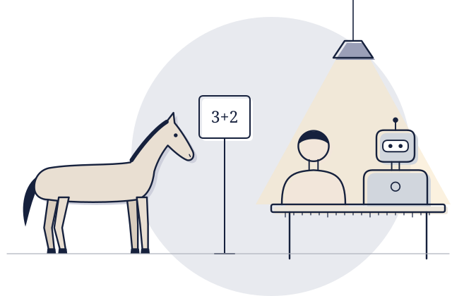
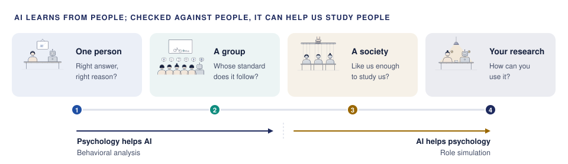
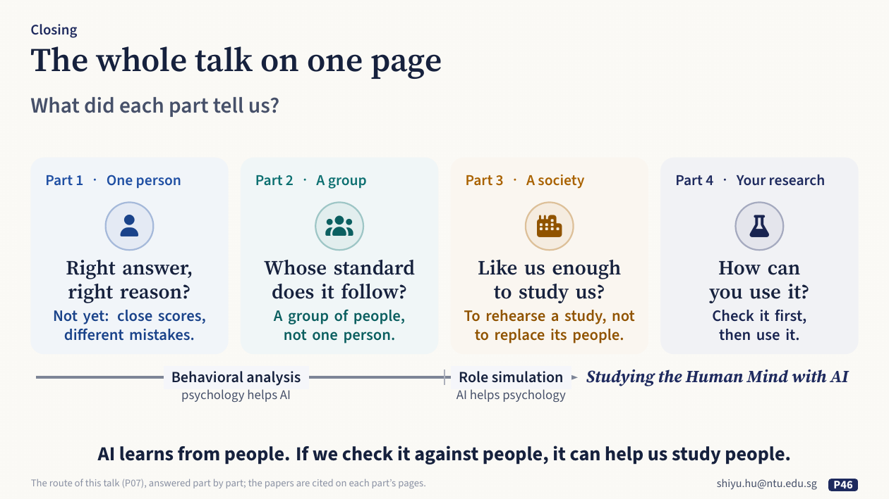

**English** · [中文](start-here.zh.md)

# Start here

You heard the talk *Studying the Human Mind with AI: From Behavioral Analysis to Role Simulation*, or someone sent you this link. This page
takes five minutes. It says what the talk was about, how this repository is organised, and
where to go next.

## The one question

**It looks capable. How would we know it really is?**

In September 2026, the US government told its agencies to stop saying "artificial intelligence"
and to say "super intelligence" instead, because the technology is "not simply imitating or
automating human intelligence" ([fact sheet](https://www.whitehouse.gov/fact-sheets/2026/09/fact-sheet-president-donald-j-trump-inaugurates-the-era-of-super-intelligence/);
[order](https://www.whitehouse.gov/presidential-actions/2026/09/inaugurating-the-era-of-super-intelligence/)).
A new name does not settle what intelligence is. Even the best-known definition of
superintelligence, "an intellect that is much smarter than the best human brains in practically
every field" (Bostrom, 1998, [text](https://nickbostrom.com/superintelligence)), is measured
against people. Turing had stepped around the definition in 1950: he replaced "Can machines
think?" with a test against people, the Turing test ([doi](https://doi.org/10.1093/mind/lix.236.433)).
The talk opened with one real game from a recent run of that test: the judge took the AI for
the human ([card](../resources/examples/jones2026-turing-test.md)). Across all games, GPT-4.5 told
to act like a shy young person was picked as the human 73% of the time; without that persona,
36%. It fooled the judges, and that shows how we judge, not that it can think. The test tells us
about AI, and also about our own judgements.

Psychology is in the same position: it cannot open a mind, so it reads the mind from behaviour,
against people. The older field and the younger one are natural partners, and AI has borrowed
from psychology all along:

| From psychology | Borrowed by AI |
|---|---|
| How a right answer can have a wrong reason: Clever Hans (1904) | shortcut learning (2020; [Part 1](part1-people-next-to-machine.md)) |
| How people see: a theory of human vision (Zhaoping, 2023) | the speaker's group's tracker (2024; [Part 1](part1-people-next-to-machine.md)) |
| How to judge: Thurstone's paired comparisons (1927) | how ChatGPT learned what people prefer (2022; [Part 2](part2-people-as-the-answer.md)) |
| How we read events: Heider and Simmel's moving shapes (1944) | scoring by a group of people, in the speaker's group's work (2024; [Part 2](part2-people-as-the-answer.md)) |
| How to be a person: the Big Five (Goldberg, 1990, [doi](https://doi.org/10.1037/0022-3514.59.6.1216)) | the speaker's group's virtual students, with personas (2025; [Part 3](part3-people-we-make.md)) |

The direction can also go the other way: once a model passes the checks, it can give something
back to the study of people.

The talk in one sentence: **AI learns from people; checked against people, it can help us study
people.**

## The talk in four parts

Four questions, each a little bigger than the last: one person, a group, a society, and your own
research. Halfway, the direction changes: at first psychology helps us test AI (behavioral
analysis, Parts 1–2); later, AI helps us study people (role simulation, Parts 3–4).

| Part | The question | What the talk found | Guide |
|---|---|---|---|
| 1 · One person: people next to the machine | Right answer, right reason? | Not yet: close scores, different mistakes. To check the reason, **compare the mistakes, not only the scores**. | [Part 1](part1-people-next-to-machine.md) |
| 2 · A group: people as the answer | Whose standard does it follow? | A group of people, not one person. To check the standard, **compare with a group, not one person**. | [Part 2](part2-people-as-the-answer.md) |
| 3 · A society: people we make | Is it like us enough to study us? | To rehearse a study, not to replace its people. To check a simulation, **compare it with real people**. | [Part 3](part3-people-we-make.md) |
| 4 · AI in your own research | How can you use it? | **Check it first, then use it**: analysing your data, test on new people and try the cue alone; measuring with your labels, keep every rater, since their agreement is the ceiling; simulating people, see the whole spread and check it over time. | [Part 4](part4-ai-in-your-research.md) |

*Slide 46 of the talk: the whole talk on one page.*

The checks in bold are ones psychology already has. Each test also taught us about people: how
we see, how we understand events, and how we behave together. A question about AI keeps turning
into a finding about us.

Each part's guide has the same sections:
- what the talk showed, usually in the talk's order: what psychology already knew, the classic work in AI, and what the speaker's group built;
- the question behind it;
- **what it gives back to psychology**;
- **five key readings**: what each did and found, what it means for the part, and what it does not show, each with a one-page card;
- **how they connect**;
- **the wider landscape**, with all the checked references for that part;
- the talk's own studies, in their public versions;
- the terms used;
- how to work on it with an AI researcher.

## Why now

The talk closes with two things the speaker sees, and how the speaker would do research now
("Why psychology and the humanities matter more now").

- **Speed, and the checks.** Two stories from mathematics this year. In July, Claude found a
  counterexample to an 87-year-old conjecture, the Jacobian conjecture, in three dimensions and up
  ([T. Tao, blog](https://terrytao.wordpress.com/2026/07/21/a-digestion-of-the-jacobian-conjecture-counterexample/)). In October, OpenAI claimed results on hundreds of open problems
  ([github.com/openai/math](https://github.com/openai/math)), and three of the papers were withdrawn the next day
  ([Retraction Watch](https://retractionwatch.com/?p=136176)). Earlier in the year, a leading mathematician judged one AI proof a
  reasonable chapter of a PhD thesis ([W. T. Gowers, blog](https://gowers.wordpress.com/2026/05/08/a-recent-experience-with-chatgpt-5-5-pro/)). So in some fields AI already
  works like a PhD student, sometimes like an expert. Yet even the field's leaders disagree: Yann
  LeCun, a Turing Award winner, holds that training on text alone will never reach human-level
  intelligence (G. Snyder, *Newsweek*, 2025). Every claim still needs checking.
- **Making is cheap; judging is scarce.** ICLR, one of the main AI conferences, had 490 submissions
  in 2017 and 19,525 in 2026, and about 62,000 have been submitted for 2027, not yet reviewed. At
  ICLR 2026, 18,054 reviewers wrote 76,139 reviews, and the programme chairs wrote that the scale
  "made it impossible to rely on human judgement alone to consistently flag and discover problematic
  reviews" ([ICLR Blog](https://blog.iclr.cc/2026/03/31/a-retrospective-on-the-iclr-2026-review-process/)). Somebody has to read all of them.

How the speaker would do research now:

- **Outlast the model.** Ask: would it still matter if models were ten times better?
- **Let AI do; you judge.** Hand it the doing, keep the judging, and write the first draft yourself.
- **Find your own crossing.** Start from a question your field asks best, and bring AI to it. For
  example: does talking with AI add to human contact, or replace it?

The talk's view: when making things gets cheap, judging is the real work, and that has always been
the job of psychology and the humanities.

## How the talk ended

The talk ended on that view, and on a last page that points to this repository. For questions, it
gathered its answers into five, each pointing back to the pages that make it:

1. **Look past the score.** Right answer, right reason? (Part 1, and analysis in Part 4.)
2. **Compare with a group.** Whose standard? (Part 2, and measurement in Part 4.)
3. **Rehearse, don't replace.** Like us enough to study us? (Part 3, and simulation in Part 4.)
4. **Check it over time.** Does it stay itself? (The virtual students of Part 3.)
5. **Judging is psychology's job.** When making gets cheap, your training is the check.

## How much there is to read

About 300 checked references in all, in four layers. Start with the first and go as far as you like.

| Layer | What | How many |
|---|---|---|
| Close reading | [key readings](../resources/examples/), one page each: five for each of the four parts, and two more for the opening and Part 3 | 22 cards |
| A path through them | the [reading path](../resources/reading-path.md): an afternoon's start, the key readings in order, then the debates | 4 + 20 + 20 |
| The wider field | the [field-wide list](../resources/literature.md), in 19 groups across Parts 1–3 (101, 102 and 108 entries); about 250 papers, 49 data sets and 13 simulation platforms | 311 entries |
| Other ways in | reading lists [by part of the talk](../resources/README.md) (53) and [by area of psychology](../resources/students.md) (46, in five areas), which overlap with the above | 99 entries |

## Three ways in

- **You want to understand a moment of the talk.** Open the part's guide above.
- **You want to read systematically.** Follow the [reading path](../resources/reading-path.md): an afternoon's start, then one part at a time, then the debates.
- **You want to start a study with an AI researcher.** The [guide to working together](../resources/working-together.md) sets out what psychology and AI research each bring, what to agree on, and a published study to learn from for each part.

Unknown term? See the [glossary](glossary.md). Prefer paper? The [handout](handout/handout.pdf) prints the essentials.
