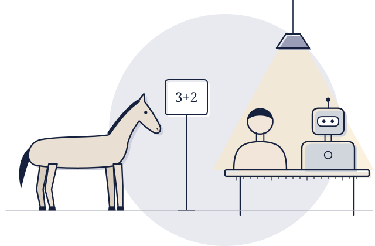
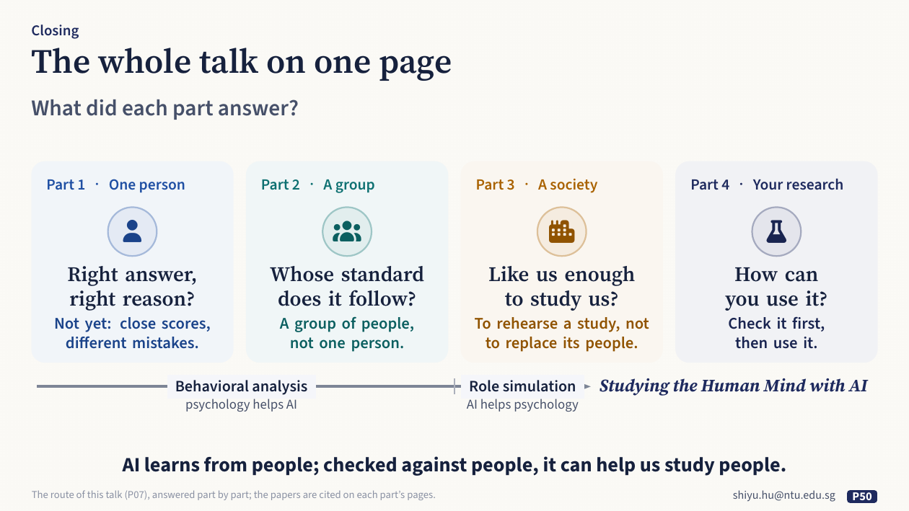
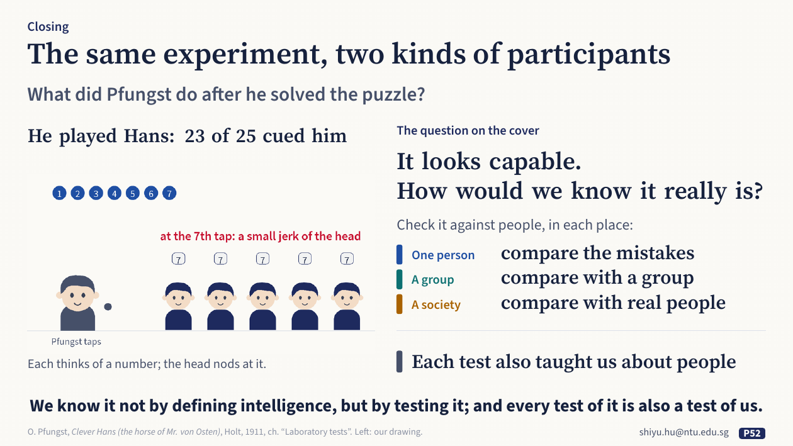

**English** · [中文](start-here.zh.md)

# Start here

You heard the talk *Studying the Human Mind with AI: From Behavioral Analysis to Role Simulation*, or someone sent you this link. This page
takes five minutes. It says what the talk was about, how this repository is organised, and
where to go next.

## The one question

**It looks capable. How would we know it really is?**

In September 2026, the US government told its agencies to stop saying "artificial intelligence"
and to say "super intelligence" instead, because the technology is "not simply imitating or
automating human intelligence" ([fact sheet](https://www.whitehouse.gov/fact-sheets/2026/09/fact-sheet-president-donald-j-trump-inaugurates-the-era-of-super-intelligence/);
[order](https://www.whitehouse.gov/presidential-actions/2026/09/inaugurating-the-era-of-super-intelligence/)).
A new name does not settle what intelligence is. Even the best-known definition of
superintelligence, "an intellect that is much smarter than the best human brains in practically
every field" (Bostrom, 1998, [text](https://nickbostrom.com/superintelligence)), is measured
against people. Turing had stepped around the definition in 1950: he replaced "Can machines
think?" with a test against people, the imitation game ([doi](https://doi.org/10.1093/mind/lix.236.433)).
The talk opened with one real game from a recent run of that test: the judge took the AI for
the human ([card](../resources/examples/jones2026-turing-test.md)). Across all games, GPT-4.5 told
to act like a shy young person was picked as the human 73% of the time; without that persona,
36%. Being picked as human tells us about the judges' cues, not yet about the machine's mind. The
test tells us about AI, and also about our own judgements.

Psychology is in the same position: it cannot open a mind, so it reads the mind from behaviour,
against people. The older field and the younger one are natural partners, and AI has borrowed
from psychology all along:

| From psychology | Borrowed by AI |
|---|---|
| How a right answer can have a wrong reason: Clever Hans (1904) | shortcut learning (2020; [Part 1](part1-people-next-to-machine.md)) |
| How people see: a theory of human vision (Zhaoping, 2023) | the speaker's group's tracker (2024; [Part 1](part1-people-next-to-machine.md)) |
| How to judge: Thurstone's paired comparisons (1927) | how ChatGPT learned what people prefer (2022; [Part 2](part2-people-as-the-answer.md)) |
| How we read events: Heider and Simmel's moving shapes (1944) | scoring by a group of people, in the speaker's group's work (2024; [Part 2](part2-people-as-the-answer.md)) |
| How to be a person: the Big Five (Goldberg, 1990, [doi](https://doi.org/10.1037/0022-3514.59.6.1216)) | the speaker's group's virtual students, with personas (2025; [Part 3](part3-people-we-make.md)) |

The direction can also go the other way: once a model passes the checks, it can give something
back to the study of people.

The talk in one sentence: **AI learns from people; checked against people, it can help us study
people.**

## The talk in four parts

Four questions, each a little bigger than the last: one person, a group, a society, and your own
research. Halfway, the direction changes: at first psychology helps us test AI (behavioral
analysis, Parts 1–2); later, AI helps us study people (role simulation, Parts 3–4).

| Part | The question | What the talk found | Guide |
|---|---|---|---|
| 1 · One person: people next to the machine | Right answer, right reason? | Not yet: close scores, different mistakes. To check the reason, **compare the mistakes, not only the scores**. | [Part 1](part1-people-next-to-machine.md) |
| 2 · A group: people as the answer | Whose standard does it follow? | A group of people, not one person. To check the standard, **compare with a group, not one person**. | [Part 2](part2-people-as-the-answer.md) |
| 3 · A society: people we make | Is it like us enough to study us? | To rehearse a study, not to replace its people. To check a simulation, **compare it with real people**. | [Part 3](part3-people-we-make.md) |
| 4 · AI in your own research | How can you use it? | **Check it first, then use it**: wherever a model enters your study, check it; most of the checks you already know. | [Part 4](part4-ai-in-your-research.md) |

*Slide 50 of the talk: the whole talk on one page.*

The checks in bold are ones psychology already has. Each test also taught us about people: how
we see, how we understand events, and how we behave together. A question about AI keeps turning
into a finding about us.

Each part's guide has the same sections:
- what the talk showed, usually in the talk's order: what psychology already knew, the classic work in AI, and what the speaker's group built;
- the question behind it;
- **what it gives back to psychology**;
- **five key readings**: what each did and found, what it means for the part, and what it does not show, each with a one-page card;
- **how they connect**;
- **the wider landscape**, with all the checked references for that part;
- the talk's own studies, in their public versions;
- the terms used;
- how to work on it with an AI researcher.

## Why now

Two trends in the talk's closing section explain why the questions above matter more each year.

- **Findings about one model age fast.** On software tasks, the tasks that the best AI models can
  finish on their own, succeeding half the time, have doubled in length about every seven months
  since 2019 (Kwa et al., METR, [arXiv:2503.14499](https://arxiv.org/abs/2503.14499)). What lasts is a good question
  and a good measure.
- **Judging has become the scarce part.** At ICLR 2026, one of the main AI conferences, 18,054
  reviewers wrote 76,139 reviews, and the programme chairs wrote that the scale "made it impossible
  to rely on human judgement alone to consistently flag and discover problematic reviews"
  ([ICLR Blog](https://blog.iclr.cc/2026/03/31/a-retrospective-on-the-iclr-2026-review-process/)).

The talk's view: when making things gets cheap, judging becomes the real work, and judging has
always been the craft of psychology and the humanities.

## How the talk ended

The talk ended where it began, with Clever Hans. After he had solved the puzzle, Pfungst played
Hans himself: he asked 25 people each to think of a number and tapped like Hans, and when he
reached it, 23 of them gave a small nod without knowing it (Pfungst, 1911,
[Project Gutenberg](https://www.gutenberg.org/ebooks/33936)). An experiment about a horse became a
finding about people. The closing line: **we know it not by defining intelligence, but by testing
it; and every test of it is also a test of us.**

*Slide 52 of the talk: the same experiment, two kinds of participants.*

## How much there is to read

About 300 checked references in all, in four layers. Start with the first and go as far as you like.

| Layer | What | How many |
|---|---|---|
| Close reading | [key readings](../resources/examples/), one page each: five for each of the four parts, and two more for the opening and a backup page | 22 cards |
| A path through them | the [reading path](../resources/reading-path.md): an afternoon's start, the key readings in order, then the debates | 4 + 20 + 20 |
| The wider field | the [field-wide list](../resources/literature.md), in 19 groups across Parts 1–3 (101, 102 and 108 entries); about 250 papers, 49 data sets and 13 simulation platforms | 311 entries |
| Other ways in | reading lists [by part of the talk](../resources/README.md) (53) and [by area of psychology](../resources/students.md) (46, in five areas), which overlap with the above | 99 entries |

## Three ways in

- **You want to understand a moment of the talk.** Open the part's guide above.
- **You want to read systematically.** Follow the [reading path](../resources/reading-path.md): an afternoon's start, then one part at a time, then the debates.
- **You want to start a study with an AI researcher.** The [guide to working together](../resources/working-together.md) sets out what psychology and AI research each bring, what to agree on, and a published study to learn from for each part.

Unknown term? See the [glossary](glossary.md). Prefer paper? The [handout](handout/handout.pdf) prints the essentials.
