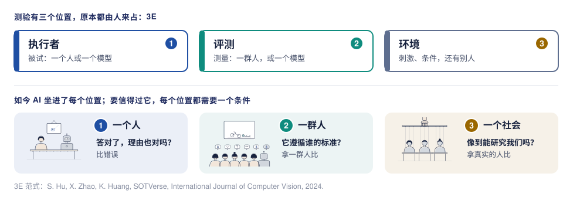

[English](start-here.md) · **中文**

# 从这里开始

你听过讲座 *Studying the Human Mind with AI: From Behavioral Analysis to Role Simulation*（用 AI 研究人的心智：从行为分析到角色模拟），或者有人把这个链接发给了你。这一页只要五分钟，说明讲座讲了什么、这个仓库怎么组织，以及接下来去哪里。

## 一个问题

**它看起来很有能力，我们怎么知道它真的具备这种能力？**

2026 年 9 月，美国政府要求各机构不再说“人工智能”（artificial intelligence），改说“超级智能”（super intelligence），理由是这项技术“不只是在模仿或自动化人的智能”（[fact sheet](https://www.whitehouse.gov/fact-sheets/2026/09/fact-sheet-president-donald-j-trump-inaugurates-the-era-of-super-intelligence/)；[行政令](https://www.whitehouse.gov/presidential-actions/2026/09/inaugurating-the-era-of-super-intelligence/)）。改了名字，智能是什么依然没有说清。就连最有名的超级智能定义，“在几乎每个领域都远比最聪明的人脑更聪明的智能”（Bostrom，1998，[原文](https://nickbostrom.com/superintelligence)），也是拿人来衡量的。图灵在 1950 年就绕开了定义：他把“机器能思考吗”换成了一个拿人来比的测试，即模仿游戏（[doi](https://doi.org/10.1093/mind/lix.236.433)）。讲座开场放的就是最近一次这种测试里真实的一局：评判者把 AI 当成了人（[卡片](../resources/examples/jones2026-turing-test.zh.md)）。在所有对局里，被要求扮演一个害羞年轻人的 GPT-4.5 有 73% 的时候被选成真人；没有这个人设，只有 36%。被选成人，反映的是评判者用了哪些线索，还不能说明机器有怎样的心智。这个测试让我们了解 AI，也让我们了解自己的判断。

心理学的处境一样：心智打不开，只能从行为去读，拿人来比。心理学是更老的学科，AI 是更年轻的学科，两者是天然的搭档，而 AI 一直在向心理学借东西：

| 来自心理学 | AI 借去之后 |
|---|---|
| 答对了，理由却可能不对：聪明的汉斯（1904） | 捷径学习（2020；[第 1 部分](part1-people-next-to-machine.zh.md)） |
| 人怎样看：一种关于人类视觉的理论（Zhaoping，2023） | 讲者团队的跟踪器（2024；[第 1 部分](part1-people-next-to-machine.zh.md)） |
| 怎样判断：Thurstone 的成对比较（1927） | ChatGPT 怎样学会人的偏好（2022；[第 2 部分](part2-people-as-the-answer.zh.md)） |
| 人怎样理解事件：Heider 和 Simmel 的移动图形（1944） | 讲者团队工作中的按一群人打分（2024；[第 2 部分](part2-people-as-the-answer.zh.md)） |
| 怎样像一个人：大五人格（Goldberg，1990，[doi](https://doi.org/10.1037/0022-3514.59.6.1216)） | 讲者团队带人设的虚拟学生（2025；[第 3 部分](part3-people-we-make.zh.md)） |

方向也可以反过来：模型通过了检验之后，也能反过来帮助研究人。

讲座的一句话：**AI 向人学习；经过人的检验之后，它也能帮助我们研究人。**

## 讲座的四个部分

四个问题，一个比一个大：一个人、一群人、一个社会，再到你自己的研究。走到一半，方向反了过来：前半程是心理学帮我们检验 AI（行为分析，第 1–2 部分），后半程是 AI 帮我们研究人（角色模拟，第 3–4 部分）。

| 部分 | 问题 | 讲座的回答 | 导读 |
|---|---|---|---|
| 1 · 一个人：机器旁边的人 | 答对了，理由也对吗？ | 还没有：分数相近，错误不同。要检验理由，就**比错误，不只比分数**。 | [第 1 部分](part1-people-next-to-machine.zh.md) |
| 2 · 一群人：人作为答案 | 它遵循谁的标准？ | 一群人，而不是一个人。要检验标准，就**拿一群人比，不拿一个人比**。 | [第 2 部分](part2-people-as-the-answer.zh.md) |
| 3 · 一个社会：我们造出来的人 | 它像我们，像到能研究我们吗？ | 用来预演一项研究，不能取代研究里的人。要检验模拟，就**拿真实的人比**。 | [第 3 部分](part3-people-we-make.zh.md) |
| 4 · 在你自己的研究里用 AI | 你可以怎样用它？ | **先检验，再使用**：模型从哪个环节进入你的研究，就在哪里检验它；这些检验大多你早已熟悉。 | [第 4 部分](part4-ai-in-your-research.zh.md) |

*讲座第 50 页：一页看完整场讲座。*

加粗的这几个检验，都是心理学本来就有的。每一次检验也让我们了解人：我们怎样看、怎样理解事件、怎样在一起行动。一个关于 AI 的问题，一次次变成了关于我们自己的发现。

每部分的导读都有相同的几节：
- 讲座里讲了什么，通常按讲座的顺序：心理学早就知道的，AI 领域的经典工作，以及讲者团队做了什么；
- 背后的问题；
- **反过来，对心理学有什么用**；
- **五篇重点必读**：每篇做了什么、发现了什么、对这一部分意味着什么、没有表明什么，每篇另有一张一页纸的卡片；
- **它们之间的关系**；
- **更大的版图**：这部分所有核实过的参考文献；
- 讲座里讲者团队自己的研究（只列公开版本）；
- 用到的术语；
- 怎样和 AI 研究者一起做。

## 为什么是现在

讲座收尾时讲了两个趋势，说明上面这些问题为什么一年比一年重要。

- **关于某一个模型的发现，过时得很快。** 在软件任务上，最好的 AI 模型能独立完成、成功率一半的任务，长度自 2019 年以来大约每七个月翻一番（Kwa 等，METR，[arXiv:2503.14499](https://arxiv.org/abs/2503.14499)）。能留下来的，是好的问题和好的测量。
- **评判成了稀缺的那一环。** AI 主要会议之一 ICLR 2026 上，18,054 位审稿人写了 76,139 份审稿意见。程序主席写道，这样的规模“使得只靠人的判断来一致地标记和发现有问题的审稿意见成为不可能”（[ICLR Blog](https://blog.iclr.cc/2026/03/31/a-retrospective-on-the-iclr-2026-review-process/)）。

讲座的看法是：当造东西变得便宜，判断就成了真正的工作；而判断，一直是心理学和人文学科的手艺。

## 讲座怎样结束

讲座在开头的地方结束：聪明的汉斯。解开谜题之后，Pfungst 自己扮演汉斯：他请 25 个人各想一个数字，然后像汉斯那样敲；敲到那个数字时，其中 23 个人的头会轻轻一点，而他们自己并不知道（Pfungst，1911，[Project Gutenberg](https://www.gutenberg.org/ebooks/33936)）。一个关于马的实验，变成了一个关于人的发现。讲座的最后一句：**我们不是通过给智能下定义来认识它，而是通过检验；而每次检验机器，也是在检验我们自己。**

*讲座第 52 页：同一个实验，两种被试。*

## 四个问题背后：测验的三个位置

给想深究的读者。对模型的测试，和一个心理学实验有着同样的组成部分，这就是讲者博士阶段工作中的 3E 范式：**执行者**（被试）、**评测**（测量）和**环境**（刺激和条件）。这三个位置原本都由人来占。讲座的前三部分，跟着 AI 走进了每一个位置：它和我们并排做测验，它开始当裁判，它扮演我们身边的人。每个位置所需要的那种可信，心理学有一个更老的词：效度。

## 一共有多少可读

合计约 300 篇核实过的参考文献，分四层。从第一层开始，读到哪里都可以。

| 层次 | 内容 | 数量 |
|---|---|---|
| 精读 | [重点必读卡片](../resources/examples/README.zh.md)，每篇一页：讲座四个部分各五篇，另有两篇配合开场和一张备用页 | 22 张 |
| 一步一步读 | [阅读路线](../resources/reading-path.zh.md)：一个下午的入门，按顺序读重点必读，最后读争论 | 4 + 20 + 20 篇 |
| 更大的版图 | [全领域文献清单](../resources/literature.md)（英文），第 1–3 部分共 19 组（101、102、108 条）；其中约 250 篇论文、49 个数据集、13 个模拟平台 | 311 条 |
| 其他入口 | [按讲座部分](../resources/README.md)（53 条）和[按心理学方向](../resources/students.md)（46 条，五个方向）的阅读清单（英文），和上面有大量重合 | 99 条 |

## 三种进入方式

- **想弄懂讲座里的某一段。** 打开上面对应部分的导读。
- **想系统地读。** 跟着[阅读路线](../resources/reading-path.zh.md)走：先用一个下午入门，再一部分一部分读，最后读争论。
- **想和 AI 研究者一起做研究。** [一起做研究的指南](../resources/working-together.zh.md)说明了心理学和 AI 研究各带来什么、要谈妥什么，并为每部分推荐了一项可以借鉴的已发表研究。

遇到不认识的术语？查[词典](glossary.zh.md)。更喜欢纸质的？[讲义](handout/handout.zh.pdf)可以打印，要点都在上面。
